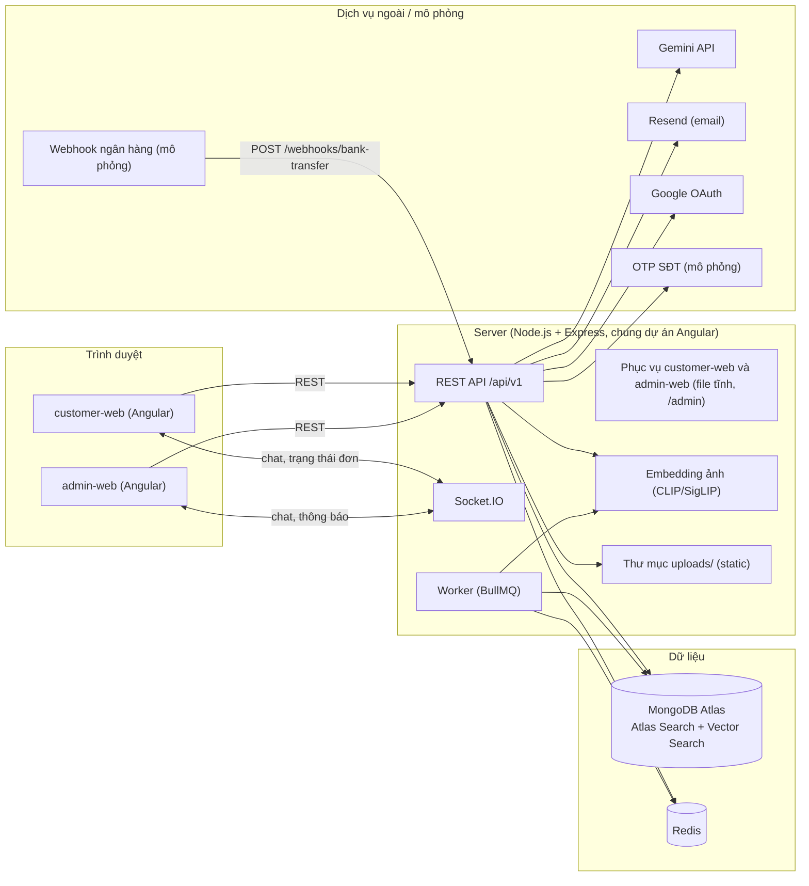
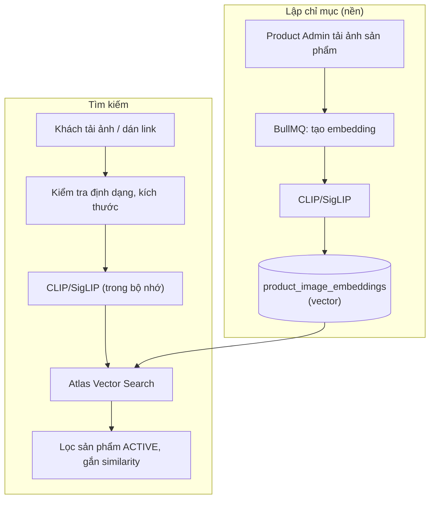
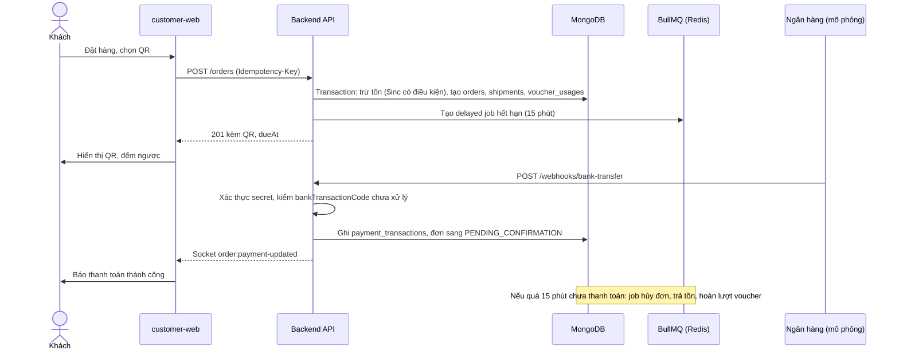

# ARCHITECTURE – CARAVESO

Tài liệu mô tả kiến trúc hệ thống ở mức đồ án, suy ra từ Functional Requirements, Database Design và API Contract. Các mục đánh dấu **(đề xuất)** là quyết định chưa được nhóm xác nhận chính thức.

---

## 1. Tổng quan kiến trúc

Hệ thống gồm hai ứng dụng Angular (khách hàng và admin), một backend Node.js + Express cung cấp REST API và Socket.IO, một worker xử lý tác vụ nền, MongoDB Atlas làm cơ sở dữ liệu và Redis làm bộ nhớ đệm/hàng đợi.



Toàn bộ nằm trong **một Angular workspace, một `package.json`**. Express vừa phục vụ API, Socket.IO, thư mục `uploads/`, vừa phục vụ hai app Angular nên cùng origin, không cần CORS. API và Worker dùng chung thư mục `server/`, chạy thành hai tiến trình (`npm run start:api`, `npm run start:worker`).

---

## 2. Công nghệ sử dụng

| Lớp | Công nghệ | Ghi chú |
| :-- | :-- | :-- |
| Frontend khách | Angular (CSR) | Chạy trên trình duyệt |
| Frontend admin | Angular (CSR) | App riêng |
| Hiển thị 3D | Three.js (GLTFLoader, OrbitControls) | Xem mục 5.9 |
| Backend | Node.js + Express | Mongoose, kiểm tra dữ liệu bằng Zod hoặc Joi **(đề xuất)** |
| Cơ sở dữ liệu | MongoDB Atlas | Có sẵn replica set (cần cho transaction) |
| Tìm kiếm văn bản | MongoDB Atlas Search | Fuzzy, chuẩn hóa tiếng Việt, từ điển đồng nghĩa |
| Tìm bằng ảnh | CLIP/SigLIP + Atlas Vector Search | Xem mục 5.6 |
| Tìm bằng AI | Gemini API | Xem mục 5.7 |
| Cache, hàng đợi | Redis + BullMQ | Xem mục 5.8 |
| Realtime | Socket.IO | Chat CSKH, cập nhật thanh toán và trạng thái đơn |
| Email | Resend | OTP email, liên kết đặt mật khẩu Admin, tóm tắt tồn kho, hóa đơn điện tử (khi khách chọn) |
| OTP số điện thoại | Mô phỏng | Mã OTP ghi ra log backend ở môi trường dev |
| Đăng nhập Google | Google Identity Services | Client gửi `idToken`, backend xác minh |
| Thanh toán QR | Mô phỏng webhook ngân hàng | Xem mục 5.2 |
| Hóa đơn PDF | Puppeteer | Xem mục 5.10 |
| Lưu file | Thư mục `uploads/` trên backend | Xem mục 5.5 |

---

## 3. Cấu trúc repo

Một Angular workspace (tạo bằng Angular CLI), thêm thư mục `server/` cho Express. Dùng TypeScript cho cả hai phía **(đề xuất)** để dùng chung model và enum.

```
caraveso/
├── docs/                # tài liệu kỹ thuật (xem bảng dưới)
├── projects/
│   ├── customer-web/    # app khách
│   ├── admin-web/       # app admin
│   └── shared/          # model, API client dùng chung
├── server/              # Express API + worker
├── uploads/             # file tải lên (không commit)
├── .github/             # pull_request_template.md
├── docker-compose.yml   # Redis chạy local
├── README.md  .env.example  .gitignore
└── package.json
```

Tài liệu trong `docs/`:

| File | Nội dung |
| :-- | :-- |
| `overview.md` | Tổng quan dự án |
| `requirements.md` | Yêu cầu chức năng (Functional Requirements) |
| `architecture.md` | Kiến trúc (tài liệu này) |
| `database-design.md` | Thiết kế cơ sở dữ liệu MongoDB |
| `api-design.md` | Hợp đồng API (API Contract) |
| `conventions.md` | Quy ước code |
| `git-workflow.md` | Quy trình Git |

Bên trong mỗi app Angular:

```
src/app/
├── core/       # auth, interceptor, guard, socket
├── layout/     # header, footer
├── shared/     # component dùng lại
└── features/   # mỗi chức năng một thư mục, lazy load (products, cart, orders...)
```

Bên trong `server/`:

```
src/
├── modules/      # mỗi nghiệp vụ một thư mục (auth, products, orders...)
├── middlewares/  # auth, rbac, validate, idempotency, rateLimit, audit
├── jobs/         # BullMQ
├── integrations/ # gemini, resend, google, embedding
├── config/
└── server.ts  worker.ts
```

Quy ước: component standalone, route của feature lazy load, token gắn bằng HTTP interceptor, phân quyền route bằng guard. Model trong `projects/shared` đặt tên khớp collection và enum ở Database Design.

**Cách chạy**

| Môi trường | Lệnh |
| :-- | :-- |
| Dev | `ng serve customer-web` và `ng serve admin-web` (có `proxy.conf.json` chuyển `/api`, `/socket.io`, `/uploads` sang server), `npm run dev:server`, `npm run dev:worker` |
| Production/demo | `ng build customer-web` và `ng build admin-web`, Express phục vụ file tĩnh của customer-web (gốc) và admin-web (`/admin`), API ở `/api/v1` |

---

## 4. Thành phần backend

Mô hình phân lớp: `route → middleware → controller → service → model (Mongoose)`. Nghiệp vụ nằm ở `service`, controller chỉ nhận và trả dữ liệu.

| Middleware | Nhiệm vụ | Tham chiếu |
| :-- | :-- | :-- |
| `auth` | Xác thực access token, chặn tài khoản `LOCKED`, `mustChangePassword` | API 0.2 |
| `rbac` | Kiểm quyền theo ma trận cố định, mặc định chỉ Super Admin | FR mục 5, NF-A03 |
| `validate` | Kiểm tra body, query, param | API 0.3 |
| `idempotency` | Lưu `Idempotency-Key` trong Redis, trả lại kết quả cũ | NF-08 |
| `rateLimit` | Giới hạn OTP, tìm ảnh, AI cho Guest (lưu Redis) | NF-16 |
| `audit` | Ghi `audit_logs`, bỏ mật khẩu và số tài khoản | NF-A04 |
| `error` | Chuẩn hóa lỗi theo `error.code` | API 0.4 |

---

## 5. Các quyết định kiến trúc chính

### 5.1. Giữ tồn kho và chống bán vượt (NF-08)

- Tồn kho được giữ ngay khi tạo đơn (FR-31). Trừ bằng `findOneAndUpdate({ _id, stockQuantity: { $gte: qty } }, { $inc: { stockQuantity: -qty } })`. Không đủ thì trả `409 INSUFFICIENT_STOCK`.
- Tạo đơn chạy trong **một transaction MongoDB** (cần replica set, Atlas có sẵn): trừ tồn, tạo `orders`, `shipments`, `voucher_usages`, ghi `stock_histories`, tăng `vouchers.usedCount`.
- Trả tồn khi đơn bị hủy hoặc hết hạn thanh toán (`ORDER_CANCEL_RESTORE`), đồng thời hoàn lượt voucher.
- `POST /orders` bắt buộc `Idempotency-Key` để không tạo đơn trùng.

### 5.2. Thanh toán QR và webhook (mô phỏng)

- Mỗi đơn QR có `payment.transferContent` duy nhất và `payment.dueAt` = lúc tạo + 15 phút.
- Hệ thống có **bộ mô phỏng ngân hàng** (script hoặc trang dev của admin) gọi `POST /webhooks/bank-transfer` với cùng định dạng payload của nhà cung cấp thật, để sau này thay bằng SePay, Casso hay PayOS mà không đổi logic.
- Webhook xác thực bằng secret trong header, luôn trả `200`, xử lý **một lần** theo `bankTransactionCode` (unique index).
- Giao dịch khớp: ghi `payment_transactions`, chuyển đơn sang `PENDING_CONFIRMATION`, đẩy socket `order:payment-updated`. Giao dịch lệch (sai nội dung, thiếu/thừa tiền, sau hạn): lưu để Order Admin đối soát (OA-08) và tạo thông báo `RECONCILIATION`.

### 5.3. Xác thực và phiên (Redis)

- Access token JWT sống 15 phút. Refresh token là chuỗi ngẫu nhiên, lưu **bản băm** trong Redis kèm TTL, gửi qua cookie `httpOnly; Secure; SameSite=Strict`.
- Nhờ Redis nên **không cần collection `refresh_tokens`**: logout, khóa tài khoản, ẩn danh hóa chỉ cần xóa khóa Redis tương ứng.
- Admin: mỗi lần refresh đặt lại TTL 30 phút. Quá 30 phút không thao tác thì refresh trả `401 SESSION_EXPIRED` (NF-A02).
- Khóa đăng nhập sai (FR-02): đếm lần sai và thời gian khóa trong `users.security`, tính thời gian còn lại từ `lockedUntil`.
- OTP email gửi bằng Resend. OTP số điện thoại mô phỏng: ghi mã ra log, không gửi SMS. Mã chỉ lưu dạng băm trong `otps`.

### 5.4. Phân quyền

Ma trận 4 vai trò cố định, kiểm bằng middleware `rbac` theo route. Route chưa khai báo quyền thì chỉ `SUPER_ADMIN` gọi được (deny mặc định). Frontend admin ẩn menu theo vai trò, nhưng quyền thật luôn do backend kiểm.

### 5.5. Lưu file

- File tải lên được lưu ở thư mục `uploads/` (gốc dự án), Express phục vụ như file tĩnh (`/uploads/...`). Đổi tên ngẫu nhiên khi lưu và kiểm MIME thực tế bằng magic bytes.
- **Không lưu vào `src/assets` của Angular**: thư mục này được đóng gói lúc build, không ghi thêm được lúc chạy. `assets` chỉ dùng cho logo, icon và ảnh tĩnh của giao diện, ảnh sản phẩm mẫu seed có thể để trong `server/seed/`.
- Đặt phía sau một `StorageService` (`save`, `delete`, `getUrl`) để sau này đổi sang Cloudinary hoặc S3 mà không sửa nghiệp vụ.
- Ảnh tìm kiếm của khách chỉ xử lý trong bộ nhớ, không ghi vào `uploads/` (FR-16, NF-07).

### 5.6. Tìm kiếm

**Tìm thủ công (FR-15)** dùng Atlas Search trên `products`:

- Index dùng analyzer tùy chỉnh có `icuFolding` (bỏ dấu, không phân biệt hoa thường) và `autocomplete` cho gợi ý khi gõ.
- Dùng `fuzzy` để chịu lỗi gõ nhẹ. Fuzzy không xử lý được đồng nghĩa và không dấu, nên cần thêm hai bước trên.
- Từ đồng nghĩa (sofa, ghế sofa, ghế bành) cấu hình bằng **synonym mapping** của Atlas Search, nguồn là một collection riêng `search_synonyms`.
- Tìm theo SKU: backend bỏ dấu chấm trong từ khóa, đối chiếu với `sku` đã chuẩn hóa.
- Chỉ trả sản phẩm `ACTIVE`.

**Tìm bằng ảnh (FR-16)**:



- Mô hình embedding chạy trong Node bằng `@huggingface/transformers` (transformers.js) **(đề xuất)**, tránh dựng thêm dịch vụ Python. Nếu hiệu năng không đạt NF-02 (≤ 5 giây) thì tách thành dịch vụ riêng.
- Vector chỉ nên tạo cho ảnh sản phẩm chính. Khi Product Admin đổi ảnh, job tạo lại vector.
- Link ảnh không tải được: `IMAGE_URL_INVALID`. Dịch vụ lỗi: `IMAGE_SEARCH_UNAVAILABLE`.

### 5.7. Tìm bằng AI (Gemini)

1. Backend gửi câu của khách cho Gemini, yêu cầu **đầu ra có cấu trúc (JSON)** gồm loại sản phẩm, màu, chất liệu, ngân sách, loại phòng, diện tích, kích thước, số lượng, hoặc `followUpQuestion`.
2. Backend dùng JSON đó làm bộ lọc để truy vấn Atlas Search/MongoDB. **Gemini không trả sản phẩm**, nên không thể bịa sản phẩm, giá hay tình trạng hàng (FR-17).
3. Không có kết quả thì nới lỏng điều kiện (`relaxed = true`).
4. Câu ngoài chủ đề nội thất: trả `OFF_TOPIC`, không trừ lượt.
5. Lượt AI của Guest đếm trong Redis theo `X-Guest-Session-Id` kết hợp IP (khóa `ai:guest:<id>`, TTL theo phiên). Người dùng đăng nhập không giới hạn.
6. Gemini lỗi hoặc hết hạn mức: trả `503 AI_UNAVAILABLE`, không trừ lượt, frontend chuyển sang tìm thủ công.
7. API key chỉ nằm ở backend (`.env`), không đưa xuống frontend.

### 5.8. Tác vụ nền (BullMQ + Redis)

| Job | Cách chạy | Nội dung |
| :-- | :-- | :-- |
| Hết hạn thanh toán | **Delayed job** tạo cùng lúc tạo đơn (trễ 15 phút) | Hủy đơn, trả tồn, hoàn lượt voucher. Thêm job quét 1 phút/lần làm lưới an toàn nếu job bị mất |
| Voucher bù giao trễ | Repeatable, 1 giờ | Tạo `late_compensation_requests` |
| Nhãn Bán chạy | Repeatable, hằng ngày | Tính `isAutoBestSeller` |
| Cảnh báo tồn kho | Repeatable, hằng ngày | Gửi email tóm tắt qua Resend |
| Hết hạn dữ liệu | Repeatable, hằng ngày | `user_vouchers`, `warranty_cards`, `promotions` đổi trạng thái |
| Dọn OTP | TTL index MongoDB trên `expiresAt` | Không cần job |
| Tạo embedding ảnh | Theo sự kiện | Mục 5.6 |
| Tạo hóa đơn PDF | Theo sự kiện | Mục 5.10 |

Mỗi job phải **idempotent** (chạy lại không gây sai dữ liệu), vì BullMQ có thể thử lại khi lỗi.

### 5.9. Hiển thị 3D (View your Room, FR-23)

React Three Fiber là thư viện của React nên **không dùng được trực tiếp trong Angular**. Phương án:

- **Three.js thuần** trong một Angular component và service quản lý scene **(đề xuất)**: `GLTFLoader` nạp file `.glb`, `OrbitControls` để xoay, zoom, `TransformControls`/`DragControls` để đặt và di chuyển sản phẩm trong phòng.
- Phương án thay thế: thư viện `angular-three` (cùng ý tưởng với R3F nhưng cho Angular), hoặc `<model-viewer>` nếu chỉ cần xem từng sản phẩm.
- Sản phẩm không có model `MODEL_3D` thì ẩn chức năng (`has3DModel = false`).

### 5.10. Hóa đơn điện tử (PDF)

- Khi đơn chuyển sang `DELIVERED`, hệ thống đưa một job vào BullMQ để tạo hóa đơn, đúng quy định FR (chỉ phát hành sau khi giao thành công, không xuất thủ công).
- Job render mẫu HTML bằng **Puppeteer** thành PDF, lưu ở `uploads/invoices/`, ghi `invoices.fileUrl` và `invoiceNumber`. Thông tin người mua lấy từ `orders.invoiceInfo` (FR-45).
- Nếu khách chọn nhận hóa đơn qua email (`invoiceInfo.sendEmail`), job gửi email kèm PDF qua Resend, ghi `invoices.emailSentAt`. Gửi lỗi thì BullMQ thử lại, hết lượt chỉ ghi log.
- Puppeteer cần Chromium. Khi deploy lên Render phải dùng Docker image có Chromium. Nếu quá nặng, thay bằng thư viện nhẹ hơn (PDFKit).

### 5.11. Realtime (Socket.IO)

- Kết nối kèm access token. Mỗi người một room `user:<id>`, mỗi phiên chat một room `chat:<sessionId>`, nhân viên CSKH thêm room `agents`.
- Sự kiện: `chat:*`, `order:payment-updated`, `order:status-updated`, `notification:new` (chỉ Admin), như API Contract mục 13.
- Chạy một instance nên chưa cần Redis adapter. Khi scale ngang mới thêm.

---

## 6. Luồng đặt hàng và thanh toán QR



---

## 7. Triển khai

| Giai đoạn | Cách chạy |
| :-- | :-- |
| Demo local | MongoDB Atlas (cần internet), Redis chạy bằng `docker-compose`, chạy theo bảng "Cách chạy" ở mục 3 |
| Demo online (khi hoàn thiện) | Cả dự án lên **Render** (một web service chạy server và file tĩnh, một worker chạy BullMQ), Redis dùng dịch vụ Redis của Render hoặc Upstash. **Không dùng Vercel** vì Socket.IO và BullMQ cần tiến trình chạy liên tục |

Biến môi trường chính (liệt kê trong `.env.example`): `MONGODB_URI`, `REDIS_URL`, `JWT_SECRET`, `COOKIE_SECRET`, `RESEND_API_KEY`, `GEMINI_API_KEY`, `GOOGLE_CLIENT_ID`, `BANK_WEBHOOK_SECRET`. Cùng origin nên không cần cấu hình CORS ở production, chỉ cần ở dev nếu không dùng proxy.

Lưu ý khi deploy online: thư mục `uploads/` trên Render mặc định **mất khi redeploy**. Trước khi demo online cần gắn ổ đĩa lưu trữ hoặc chuyển sang Cloudinary (đổi ở `StorageService`).

---

## 8. Điều chỉnh cần đồng bộ sang Database Design và API Contract

| # | Nội dung | Việc cần làm |
| :-- | :-- | :-- |
| 1 | Vector ảnh sản phẩm | Thêm collection `product_image_embeddings` (`productId`, `mediaUrl`, `embedding[]`, `model`, `updatedAt`) và Vector Search index |
| 2 | Từ điển đồng nghĩa | Thêm collection `search_synonyms` (`mappingType`, `synonyms[]`) làm nguồn cho Atlas Search |
| 3 | Atlas Search index | Ghi tên index và cấu hình analyzer vào Database Design |
| 4 | `refresh_tokens` | **Không cần** collection, dùng Redis. Cập nhật mục 15 điểm 1 của API Contract |
| 5 | Bộ đếm AI Guest | **Không cần** collection, dùng Redis. Cập nhật mục 15 điểm 3 của API Contract |
| 6 | `ChatMessage.messageType` | Bỏ giá trị `FILE` khỏi enum nếu không dùng |

---

## 9. Ngoài phạm vi (chưa thực hiện)

- Sao lưu và phục hồi theo NF-A07, giám sát và log tập trung theo NF-A08, CI/CD.
- Thanh toán ngân hàng thật, gửi SMS OTP thật.
- Đa instance (scale ngang), CDN, lưu file đám mây.
