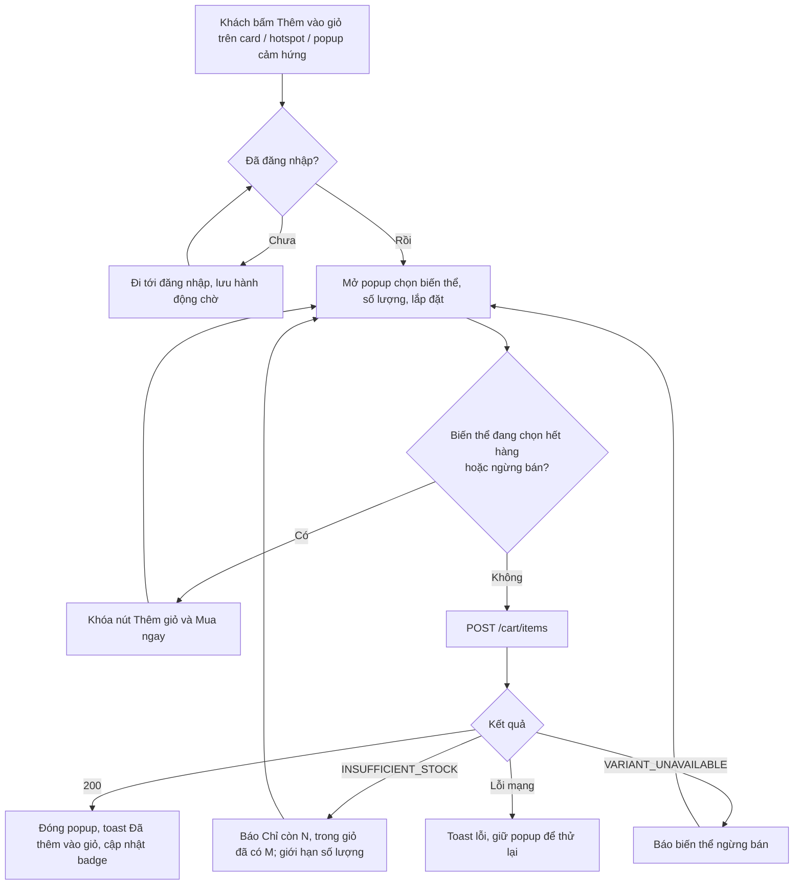
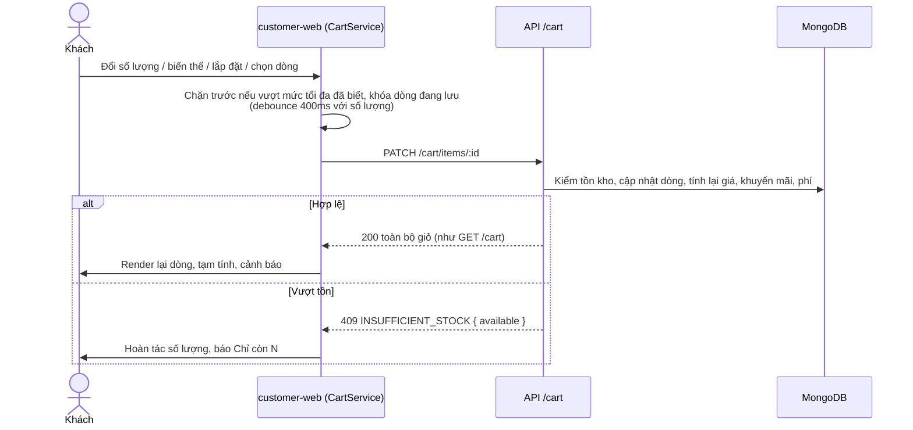
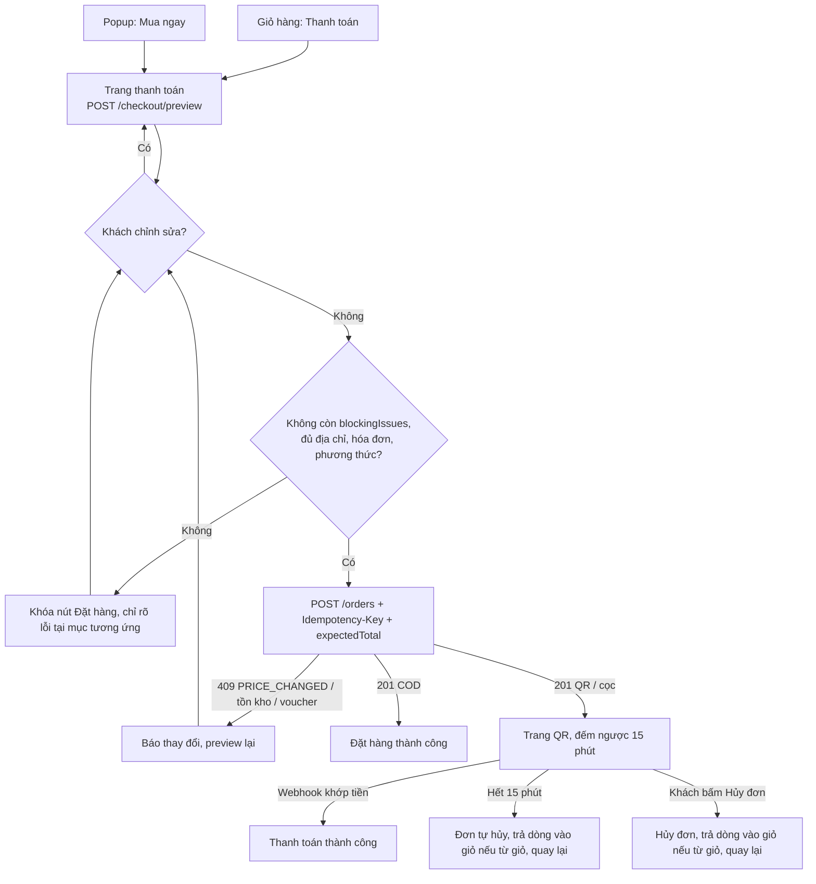
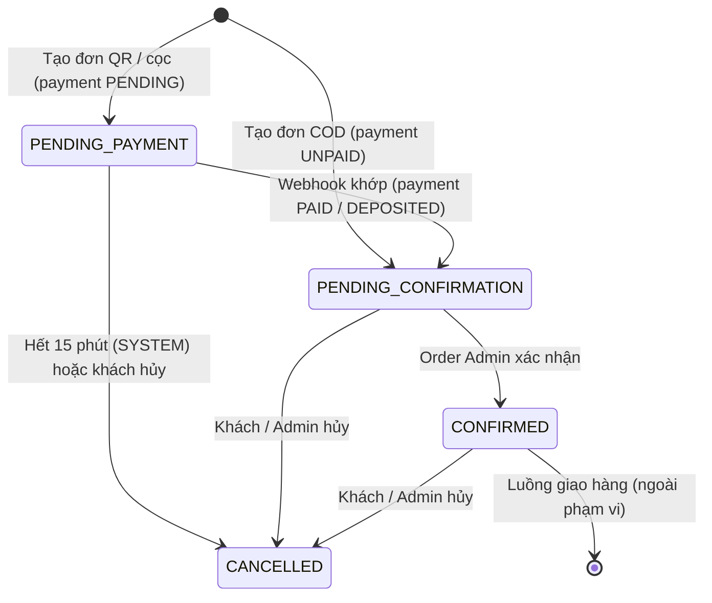

# ĐẶC TẢ GIỎ HÀNG VÀ THANH TOÁN – CARAVESO

Phạm vi: FR-28 → FR-39 và FR-45 (giỏ hàng, đặt hàng từ giỏ, mua nhanh, hẹn lịch giao, hóa đơn VAT, thanh toán COD và QR ngân hàng, đặt cọc). Tài liệu này **không thay thế** `requirements.md`, `api-design.md` (mục 7, 8, 11.4, 11b.4, 13, 14) và `database-design.md` (Cart, Order, PaymentTransaction, Shipment, Invoice); nó ghép các phần đó thành luồng nghiệp vụ, workflow và giao diện để code. Khi mâu thuẫn, `requirements.md` thắng. Các quyết định đã chốt khi viết tài liệu này nằm ở mục 6.

---

## 0. Phụ thuộc và hiện trạng code

| Phụ thuộc | Cần cho | Hiện trạng | Cách xử lý trong feature |
| :-- | :-- | :-- | :-- |
| Đăng nhập (JWT, `auth.middleware`) | Mọi API giỏ và thanh toán (quyền `U`) | Chưa có, file middleware rỗng | Tạm dùng user seed, middleware dev gán `req.user`; thay khi có auth |
| Sổ địa chỉ (FR-08, `addresses`) | Chọn địa chỉ giao hàng | Chưa có | Làm tối thiểu: liệt kê, thêm mới, địa chỉ mặc định |
| Voucher (FR-30) | Áp voucher | Chưa có | Làm sau. UI để sẵn chỗ nhưng ẩn |
| Biến thể (`product_variants`) | Giá, tồn kho, cấp vận chuyển, lắp đặt | **Có** | – |
| Khuyến mãi (`promotions`) | Giá sau khuyến mãi | **Có** | – |
| Cấu hình (`GET /config/public`) | Phí vận chuyển, ngưỡng cọc, số ngày chuẩn bị | **Có** module `config` | Bổ sung khóa `shipping.leadDays`, `invoice.vatRate` |
| Trang chi tiết sản phẩm (FR-18) | Điểm vào Thêm giỏ / Mua ngay | Chưa có | **Popup chọn biến thể là điểm vào chính** |
| Worker/BullMQ (`server/src/jobs`) | Tự hủy đơn hết hạn QR, gửi email hóa đơn | Thư mục rỗng | Làm job hết hạn thanh toán trong feature này |
| Resend (`integrations/resend.ts`) | Gửi email hóa đơn | **Có** | Dùng khi phát hành hóa đơn (ngoài phạm vi feature, chỉ lưu lựa chọn) |

---

## 1. Quy tắc dùng chung

### 1.1. Tính tiền

Áp dụng giống hệt cho giỏ hàng, trang thanh toán và lúc tạo đơn. Server tính, client chỉ hiển thị. Một hàm tính chung cho cả ba nơi.

| Đại lượng | Công thức |
| :-- | :-- |
| Đơn giá dòng `unitPrice` | `variant.salePrice` hiện tại (chưa trừ khuyến mãi) |
| Giảm khuyến mãi dòng | Theo chương trình đang chạy của sản phẩm (tối đa 1 chương trình) |
| `subtotal` | Σ `unitPrice × quantity` các dòng được chọn |
| `voucherDiscount` | PERCENT/FIXED, chặn `maxDiscountValue`. Chỉ tính trên **tiền hàng sau khuyến mãi**; không giảm phí vận chuyển và phí lắp đặt. Phân bổ vào từng dòng tỉ lệ giá trị dòng |
| `shippingFee` | Σ (phí cấp độ × `quantity`). Cấp 1: 30.000đ, 2: 80.000đ, 3: 250.000đ, 4: 450.000đ. Không phân biệt vùng |
| `installationFee` | Σ (`variant.installationFee × quantity`) các dòng `hasInstallation = true` |
| `totalAmount` | `subtotal − promotionDiscount − voucherDiscount + shippingFee + installationFee` |
| Đặt cọc | `totalAmount > 20.000.000đ` (đã gồm phí) → bắt buộc QR: cọc 30% (còn lại COD) hoặc trả toàn bộ qua QR. COD toàn bộ bị chặn |

### 1.2. Dịch vụ lắp đặt

| Mã | Quy tắc |
| :-- | :-- |
| BR-I01 | Chỉ biến thể **cấp vận chuyển 3–4** được có dịch vụ lắp đặt (giao bằng đội xe CaraVeso, lắp trong cùng chuyến). Backend từ chối `installationService ≠ NONE` với cấp 1–2 |
| BR-I02 | `NONE`: ẩn ô chọn. `OPTIONAL`: khách bật/tắt, mặc định tắt. `REQUIRED`: luôn bật, ô chọn khóa, vẫn hiển thị dòng phí riêng |
| BR-I03 | Phí = `installationFee × quantity`, tách dòng riêng, không gộp vào giá sản phẩm, không bị voucher giảm |
| BR-I04 | Lắp đặt cùng ngày giao (`shipments.installationSchedule` = ngày hẹn, nếu không hẹn thì ngày dự kiến) |
| BR-I05 | Hoàn phí lắp đặt: hủy trước khi giao hoàn 100%; khách đổi ý trả hàng sau khi đã lắp **không hoàn** (và chịu phí tháo dỡ theo FR-42); lỗi do CaraVeso hoàn đủ |

### 1.3. Ngày giao dự kiến và hẹn lịch

| Mã | Quy tắc |
| :-- | :-- |
| BR-D01 | Ngày giao dự kiến = ngày tạo đơn + số ngày chuẩn bị theo **cấp cao nhất** trong đơn: cấp 1–2 là 3 ngày, cấp 3–4 là 5 ngày. Chỉ đếm ngày làm việc Thứ 2–Thứ 7 (bỏ Chủ nhật). Số ngày lấy từ cấu hình `shipping.leadDays` |
| BR-D02 | Hẹn lịch **chỉ cho đơn có ít nhất một dòng cấp 3–4** (đội xe CaraVeso giao cả đơn). Đơn chỉ có hàng cấp 1–2 chỉ hiển thị ngày dự kiến |
| BR-D03 | Ngày hẹn trong khoảng [ngày dự kiến, ngày dự kiến + 7], trừ Chủ nhật. Khung giờ `MORNING` (8–12) hoặc `AFTERNOON` (13–17). Không giới hạn số đơn mỗi khung (mức demo) |
| BR-D04 | Hẹn lịch là tùy chọn. Đổi lịch sau khi đặt (tối đa 2 lần, trước giờ giao ≥ 24 giờ) qua `PATCH /orders/:id/delivery-schedule`; UI đổi lịch nằm ở trang chi tiết đơn (FR-10, làm sau) |
| BR-D05 | `estimatedDeliveryDate` không bị ghi đè khi hẹn lịch; mốc tính bù trễ là ngày hẹn cuối cùng nếu có (FR-36, FR-40) |

### 1.4. Hóa đơn VAT (FR-45)

| Mã | Quy tắc |
| :-- | :-- |
| BR-V01 | Ba lựa chọn: **Không cần xuất hóa đơn VAT** (mặc định), **Cá nhân**, **Công ty**. Mọi đơn vẫn được hệ thống tự phát hành hóa đơn điện tử khi giao thành công (mục 1.1 của requirements); "Không cần" nghĩa là hóa đơn ghi "Người mua không lấy hóa đơn" |
| BR-V02 | Cá nhân: Họ tên* (điền sẵn tên người nhận), Mã số thuế cá nhân hoặc số CCCD (tùy chọn, 10 hoặc 12 số), Địa chỉ* (điền sẵn địa chỉ giao) |
| BR-V03 | Công ty: Tên công ty*, Mã số thuế* (10 số hoặc dạng `10 số-3 số`), Địa chỉ công ty*. Chỉ kiểm định dạng, không tra cứu cơ quan thuế |
| BR-V04 | Ô tick **"Gửi hóa đơn qua email"** chỉ hiện khi chọn Cá nhân hoặc Công ty, mặc định không tick. Tick thì bắt buộc nhập email (điền sẵn email tài khoản). Đây là **ngoại lệ duy nhất** của luật "không gửi email giao dịch cho khách" |
| BR-V05 | Email gửi khi hóa đơn được phát hành (đơn `DELIVERED`), kèm file PDF, qua hàng đợi có thử lại. Gửi lỗi chỉ ghi log; khách vẫn tải hóa đơn trên web |
| BR-V06 | Thông tin hóa đơn chỉ nhập lúc đặt hàng, lưu bản sao vào `orders.invoiceInfo`. Lần đặt sau điền sẵn từ đơn gần nhất có xuất hóa đơn. Sửa sau khi đặt để làm cùng trang chi tiết đơn |
| BR-V07 | Giá hiển thị đã bao gồm VAT; thuế suất lấy từ cấu hình `invoice.vatRate` để in lên hóa đơn |

---

## 2. FEATURE 1 – QUẢN LÝ GIỎ HÀNG (FR-28, FR-29, FR-30)

### 2.1. Tác nhân và tiền điều kiện

- Tác nhân: Khách đã đăng nhập. Mỗi khách một giỏ (`carts.userId` unique), giỏ lưu trên server nên đồng bộ giữa các thiết bị. **Không có giỏ cho khách vãng lai.**
- Khách chưa đăng nhập bấm Thêm vào giỏ / Mua ngay / icon giỏ → chuyển tới đăng nhập, sau khi đăng nhập quay lại đúng trang và mở lại popup.
- Giỏ **không giữ hàng** (không trừ tồn kho), nhưng **không cho số lượng trong giỏ vượt tồn kho hiện tại**.

### 2.2. Ca sử dụng

| Mã | Ca sử dụng | Mô tả ngắn | API |
| :-- | :-- | :-- | :-- |
| C1 | Thêm vào giỏ | Chọn biến thể, số lượng, lắp đặt → thêm. Trùng biến thể thì cộng dồn | `POST /cart/items` |
| C2 | Xem giỏ | Danh sách dòng, cảnh báo, tạm tính các dòng được chọn | `GET /cart` |
| C3 | Đổi số lượng | `1 ≤ quantity ≤ tồn kho`; muốn bỏ thì xóa dòng | `PATCH /cart/items/:id` |
| C4 | Đổi biến thể | Trong cùng sản phẩm. Biến thể mới đã có trong giỏ thì gộp (tổng không vượt tồn) | `PATCH /cart/items/:id` |
| C5 | Bật/tắt lắp đặt | Chỉ với `OPTIONAL` | `PATCH /cart/items/:id` |
| C6 | Chọn/bỏ chọn dòng, chọn tất cả | Chỉ dòng được chọn mới tính tiền và đi thanh toán | `PATCH /cart/items/:id`, `PATCH /cart/selection` |
| C7 | Xóa dòng | Có xác nhận; xóa nhiều dòng đã chọn | `DELETE /cart/items/:id` |
| C8 | Áp/gỡ voucher *(làm sau)* | Nhập mã hoặc chọn từ ví; hiển thị lý do khi không áp được | `PUT/DELETE /cart/voucher` |
| C9 | Tiến hành thanh toán | Chuyển sang `/checkout?source=cart` | – |

### 2.3. Quy tắc nghiệp vụ

| Mã | Quy tắc |
| :-- | :-- |
| BR-C01 | Biến thể `DISCONTINUED` không thêm được (`VARIANT_UNAVAILABLE`). Dòng đã có mà biến thể ngừng bán: cảnh báo, tự bỏ chọn, chỉ cho xóa hoặc đổi biến thể |
| BR-C02 | `priceAtAdd` lưu giá lúc thêm. Giá hiện tại khác → cảnh báo `PRICE_CHANGED` (giá cũ gạch ngang, giá mới). Đổi số lượng/biến thể thì cập nhật `priceAtAdd` = giá hiện tại |
| BR-C03 | **Chặn tồn kho khi thêm/sửa**: số lượng trong giỏ (cộng dồn) không được vượt `stockQuantity`. Vượt → `409 INSUFFICIENT_STOCK { available }`. Biến thể hết hàng: nút Thêm giỏ và Mua ngay bị khóa |
| BR-C04 | Dòng đã có trong giỏ mà tồn kho giảm xuống dưới số lượng: **không tự sửa số lượng**; cảnh báo `EXCEEDS_STOCK` "Chỉ còn N sản phẩm" kèm nút "Giảm về N", tự bỏ chọn và không chọn lại được đến khi sửa |
| BR-C05 | Dòng đã có trong giỏ mà hết hàng: vẫn nằm trong giỏ (FR-29), cảnh báo `OUT_OF_STOCK`, không chọn được để thanh toán, vẫn sửa biến thể hoặc xóa |
| BR-C06 | Tình trạng hàng chỉ hiển thị 3 mức Còn hàng, Sắp hết, Hết hàng. Số tồn chính xác chỉ hiện khi khách chạm mức tối đa (BR-C03, BR-C04) |
| BR-C07 | Tạm tính chỉ tính dòng `isSelected = true`. Không có dòng nào được chọn thì nút Thanh toán bị khóa |
| BR-C08 | Mỗi đơn tối đa 1 voucher, gắn vào giỏ (`appliedVoucherId`), kiểm lại mỗi lần giỏ thay đổi; không còn hợp lệ thì giữ lại, hiện lý do, giảm giá = 0 *(làm sau cùng voucher)* |
| BR-C09 | Icon giỏ trên header hiển thị số dòng trong giỏ (badge), cập nhật sau mỗi thao tác |
| BR-C10 | Các dòng đã đặt bị xóa khỏi giỏ khi tạo đơn. Nếu đơn nguồn giỏ bị hủy khi còn `PENDING_PAYMENT` (hết hạn QR hoặc khách hủy), các dòng được **trả lại vào giỏ** (cộng dồn nếu đã có, không vượt tồn) |

### 2.4. Workflow – Thêm vào giỏ (C1)



### 2.5. Workflow – Chỉnh sửa giỏ (C3–C7)



---

## 3. FEATURE 2 – THANH TOÁN (FR-31 → FR-39, FR-45)

### 3.1. Hai nguồn thanh toán

| | Thanh toán giỏ hàng (`source = CART`) | Mua nhanh (`source = BUY_NOW`) |
| :-- | :-- | :-- |
| Điểm vào | Nút Thanh toán ở giỏ | Nút Mua ngay trong popup chọn biến thể |
| Dòng hàng | Các dòng `isSelected` của giỏ, server tự lấy | Client giữ `items` (lưu `sessionStorage` để F5 không mất) và gửi trong body |
| Chỉnh sửa tại trang thanh toán (FR-34) | Gọi API giỏ (mục 7 API) → giỏ và thanh toán dùng chung dữ liệu | Sửa đơn tạm phía client rồi gọi lại `preview`; **không đụng giỏ** |
| Sau khi tạo đơn | Xóa các dòng đã đặt khỏi giỏ | Xóa đơn tạm trong `sessionStorage` |
| Đơn bị hủy khi chờ thanh toán | Trả các dòng lại vào giỏ (BR-C10), quay về `/cart` | Quay về trang trước, đơn tạm đã mất |

### 3.2. Luồng nghiệp vụ đặt hàng

1. **Vào trang thanh toán** → `POST /checkout/preview`. Server tính lại toàn bộ (giá, khuyến mãi, phí, cọc, ngày giao dự kiến, có được hẹn lịch không) và trả `blockingIssues`. Không tạo đơn, không giữ hàng. Giỏ không có dòng nào được chọn / mất đơn tạm mua nhanh → quay về `/cart` hoặc trang chủ.
2. **Địa chỉ giao hàng** (FR-33): mặc định chọn địa chỉ mặc định. Chưa có địa chỉ → form thêm mới mở sẵn (Tỉnh/Thành phố và Phường/Xã chọn từ danh sách sau sáp nhập 2025, không có cấp huyện). Địa chỉ mới được lưu vào sổ khi bấm Thanh toán, kèm tùy chọn "Đặt làm địa chỉ mặc định". Ô Ghi chú (tối đa 500 ký tự) nằm cuối mục, lưu thành ghi chú giao hàng của đơn.
3. **Sản phẩm và lắp đặt** (FR-34, FR-35): sản phẩm chỉ hiển thị ở cột tóm tắt; sửa số lượng hoặc biến thể thì quay lại giỏ. Chọn lắp đặt (hàng `OPTIONAL`) ở mục Giao hàng và lắp đặt, mỗi thay đổi gọi lại `preview`.
4. **Giao hàng** (FR-36): hiển thị ngày dự kiến. Đơn có hàng cấp 3–4: tùy chọn hẹn ngày + khung giờ.
5. **Hóa đơn** (FR-45): chọn Không cần / Cá nhân / Công ty, nhập thông tin, tick gửi email nếu muốn.
6. **Phương thức thanh toán** (FR-38, FR-39) – xem 3.3.
7. **Đặt hàng**: `POST /orders` kèm `Idempotency-Key` (sinh một lần khi vào trang, giữ nguyên khi bấm lại) và `expectedTotal` (tổng khách đang thấy). Server trong 1 transaction: kiểm lại giá (so `expectedTotal`), tồn kho, voucher → trừ tồn kho → tạo đơn (lưu `source`, `invoiceInfo`), shipment (ngày dự kiến, lịch hẹn, lịch lắp), lượt voucher → xóa dòng giỏ (nếu `CART`).
8. **Sau khi tạo đơn**:
   - COD: đơn `PENDING_CONFIRMATION` / thanh toán `UNPAID` → trang **Đặt hàng thành công**.
   - QR (toàn bộ hoặc cọc): đơn `PENDING_PAYMENT` / `PENDING` → trang **Thanh toán QR** đếm ngược 15 phút.
9. **Thanh toán QR**: khách quét mã chuyển đúng số tiền và nội dung. Ngân hàng gọi webhook → server đối chiếu → đơn `PENDING_CONFIRMATION`, thanh toán `PAID`/`DEPOSITED` → socket `order:payment-updated` → trang QR tự chuyển sang **Thanh toán thành công**.
10. **Hết 15 phút chưa nhận tiền** hoặc **khách bấm Hủy đơn** ở trang QR: đơn `CANCELLED`, trả tồn kho, hoàn lượt voucher, trả dòng vào giỏ nếu nguồn `CART`; trang QR báo kết quả và đưa khách về trang trước.

### 3.3. Quy tắc chọn phương thức thanh toán

| Tổng thanh toán | Phương án hiển thị | `payment.method` / `collectionType` | Số tiền QR |
| :-- | :-- | :-- | :-- |
| ≤ 20.000.000đ | **COD** (mặc định) | `COD` / `FULL` | – |
| ≤ 20.000.000đ | **Chuyển khoản QR** | `BANK_TRANSFER` / `FULL` | `totalAmount` |
| > 20.000.000đ | **Đặt cọc 30% qua QR, còn lại COD** (mặc định) | `BANK_TRANSFER` / `DEPOSIT` | `depositAmount` |
| > 20.000.000đ | **Chuyển khoản QR toàn bộ** | `BANK_TRANSFER` / `FULL` | `totalAmount` |
| > 20.000.000đ | COD toàn bộ: hiển thị nhưng khóa, kèm giải thích | – (server trả `409 DEPOSIT_REQUIRED`) | – |

Khi chỉnh sửa làm tổng vượt hoặc tụt dưới ngưỡng, phương án đang chọn không còn hợp lệ → tự chuyển về phương án mặc định của nhóm mới và báo cho khách.

### 3.4. Workflow tổng thể



### 3.5. Workflow – Tạo đơn và thanh toán QR

```mermaid
sequenceDiagram
  actor K as Khách
  participant FE as customer-web
  participant API as API
  participant DB as MongoDB
  participant BANK as Ngân hàng (mô phỏng)
  participant JOB as Worker

  K->>FE: Bấm Đặt hàng
  FE->>API: POST /orders (Idempotency-Key, expectedTotal)
  API->>DB: Transaction: kiểm giá/tồn/voucher, trừ tồn (SALE),<br/>tạo order + shipment + voucher_usage, xóa dòng giỏ
  API-->>FE: 201 { orderCode, payment.qr, dueAt }
  FE->>K: QR, số tiền, nội dung CK, đếm ngược
  FE->>API: Nghe socket room user:<id> (dự phòng polling GET /orders/:id/payment mỗi 5s)

  alt Chuyển khoản đúng, trong hạn
    K->>BANK: Chuyển khoản
    BANK->>API: POST /webhooks/bank-transfer (secret)
    API->>DB: Idempotent theo bankTransactionCode → payment_transactions MATCHED,<br/>payment PAID/DEPOSITED, order PENDING_CONFIRMATION
    API-->>FE: socket order:payment-updated
    FE->>K: Thanh toán thành công
  else Sai nội dung / thiếu / thừa / trễ
    BANK->>API: POST /webhooks/bank-transfer
    API->>DB: Lưu giao dịch WRONG_CONTENT/UNDERPAID/OVERPAID/LATE → đối soát OA-08
    Note over FE: Đơn vẫn PENDING_PAYMENT; khách liên hệ CSKH kèm mã đơn
  else Hết 15 phút
    JOB->>DB: Mỗi phút: đơn PENDING_PAYMENT quá dueAt → CANCELLED (SYSTEM),<br/>trả tồn kho, hoàn lượt voucher, trả dòng vào giỏ nếu source CART
    API-->>FE: socket order:payment-updated (expired)
    FE->>K: Báo hết hạn, quay lại trang trước
  end
```

### 3.6. Trạng thái đơn và thanh toán trong phạm vi feature



### 3.7. Ngoại lệ và cách hiển thị

| Tình huống | Nơi phát hiện | Hiển thị cho khách |
| :-- | :-- | :-- |
| Giá đổi giữa preview và đặt hàng | `POST /orders` → `409 PRICE_CHANGED` kèm preview mới | Hộp thoại "Giá đã thay đổi", hiển thị tổng mới, khách bấm Đặt hàng lại |
| Hết hàng / không đủ tồn khi đặt | `preview` (blocking) hoặc `POST /orders` (`409 INSUFFICIENT_STOCK`) | Đánh dấu dòng lỗi, nút Đặt hàng khóa đến khi khách giảm số lượng hoặc xóa dòng |
| Voucher không còn hợp lệ | `preview` hoặc `POST /orders` | Báo lý do ở ô voucher, cho gỡ voucher để tiếp tục |
| Chưa có địa chỉ | `preview` (`ADDRESS_REQUIRED`) | Form địa chỉ mở sẵn, nút Đặt hàng khóa |
| Lịch hẹn không hợp lệ (ngoài khoảng, Chủ nhật, đơn không được hẹn) | `preview` (`SCHEDULE_INVALID`) | Báo lỗi tại mục Giao hàng |
| Thông tin hóa đơn thiếu/sai định dạng | Client kiểm trước; server `400 VALIDATION_ERROR` | Báo lỗi tại từng ô của mục Hóa đơn |
| Đơn > 20tr chọn COD | Client chặn trước; server `409 DEPOSIT_REQUIRED` | Lựa chọn COD khóa, ghi chú bắt buộc cọc 30% |
| Bấm Đặt hàng 2 lần / mạng chập chờn | `Idempotency-Key` | Nút khóa khi đang gửi; gửi lại cùng key trả cùng đơn |
| Rời trang QR rồi quay lại | `GET /orders/:id/payment` | Mở lại trang QR với thời gian còn lại theo server |
| Chuyển khoản sai nội dung/số tiền | Webhook | Không tự cập nhật; trang QR gợi ý liên hệ CSKH kèm mã đơn |

---

## 4. GIAO DIỆN

Theo `STYLE_GUIDE.md`: Inter, màu chính `#0B3056`, lưới 12 cột, lề 80px, gutter 24px; tái dùng `vnd.pipe`, `app-icon`, `product-card`, `compact-header`. Responsive theo NF-04: dưới 768px các cột xếp dọc, thanh tổng tiền dính đáy màn hình.

### 4.1. Màn hình và route

| Route / thành phần | Màn hình | Ghi chú |
| :-- | :-- | :-- |
| Popup (không route) | Chọn biến thể | **Điểm vào chính** cho Thêm giỏ và Mua ngay (nút trên `product-card`, hotspot, popup cảm hứng). Dữ liệu `GET /products/:id/quick-view`. Tái dùng phần chọn biến thể cho trang chi tiết sau này |
| `/cart` | Giỏ hàng | Guard đăng nhập; header chung của trang chủ ở dạng nền trắng (`data.layout = 'solid'`) |
| `/checkout?source=cart` / `/checkout?source=buy-now` | Thanh toán | Guard đăng nhập; `compact-header` bản tối giản (chỉ "Quay lại" và logo) |
| `/checkout/payment/:orderId` | Thanh toán QR | Đếm ngược, socket + polling |
| `/checkout/success/:orderId` | Đặt hàng / thanh toán thành công | Link Xem đơn hàng (FR-10, làm sau) và Tiếp tục mua sắm |

### 4.2. Popup chọn biến thể

```
┌──────────────────────────────────────────────── ✕ ┐
│ ┌──────────┐  Sofa Oslo 3 chỗ                      │
│ │   ảnh    │  14.000.000đ   ̶1̶5̶.̶0̶0̶0̶.̶0̶0̶0̶đ̶   -7%          │
│ │ biến thể │  ● Còn hàng                           │
│ └──────────┘                                       │
│ Màu sắc     [Xám ✓] [Be] [Xanh rêu]                │
│ Chất liệu   [Vải ✓] [Da]                           │
│ Kích thước  [220×95×85 ✓] [180×90×85]              │
│ Số lượng    [ − ]  2  [ + ]   Chỉ còn 2 sản phẩm   │
│ ☑ Lắp đặt tại nhà  +300.000đ / sản phẩm            │
│ Phí vận chuyển dự kiến: 250.000đ / sản phẩm        │
│                                                    │
│ [   THÊM VÀO GIỎ   ]   [■■■■ MUA NGAY ■■■■]        │
└────────────────────────────────────────────────────┘
```

- Tổ hợp biến thể không tồn tại thì làm mờ. Biến thể hết hàng vẫn bấm xem được nhưng hai nút khóa, thay bằng nhãn "Hết hàng".
- Nút + dừng ở tồn kho trừ số đã có trong giỏ; khi chạm mức mới hiện "Chỉ còn N sản phẩm".
- Ô lắp đặt chỉ hiện với biến thể có dịch vụ (cấp 3–4); `REQUIRED` thì tick sẵn và khóa, ghi "Bắt buộc lắp đặt".
- Mở từ icon giỏ thì nhấn mạnh Thêm vào giỏ, từ Mua ngay thì nhấn mạnh Mua ngay. Mở từ giỏ hàng để đổi biến thể thì chỉ còn nút "Cập nhật".

### 4.3. Giỏ hàng `/cart`

```
Header
Giỏ hàng (4)
┌───────────────────────────────────────────────────────┐ ┌──────────────────────────┐
│ ☑ Chọn tất cả (2/4)                    [Xóa đã chọn]  │ │ Tạm tính      31.500.000đ│
├───────────────────────────────────────────────────────┤ │ Khuyến mãi    −2.000.000đ│
│ ☑ ┌────┐ Sofa Oslo 3 chỗ                    [🗑]     │ │ Vận chuyển       580.000đ│
│   │ảnh │ Xám / Vải / 220×95×85 ▾                    │ │ Lắp đặt          600.000đ│
│   └────┘ 14.000.000đ  ̶1̶5̶.̶0̶0̶0̶.̶0̶0̶0̶đ̶                     │ │ ──────────────────────── │
│          ⚠ Giá đã thay đổi từ 15.000.000đ            │ │ Tổng        30.680.000đ  │
│          [−] 2 [+]   ☑ Lắp đặt +600.000đ             │ │ Đơn trên 20tr cần cọc 30%│
├───────────────────────────────────────────────────────┤ │                          │
│ ☑ ┌────┐ Bàn trà Nordic                     [🗑]     │ │ [■■ THANH TOÁN (2) ■■]   │
│   │ảnh │ Gỗ sồi / 120×60 ▾          ● Sắp hết         │ └──────────────────────────┘
│   └────┘ 3.500.000đ   [−] 1 [+]                      │
├───────────────────────────────────────────────────────┤
│ ☐ ┌────┐ Kệ sách Linea  (khóa chọn)         [🗑]     │
│   │ảnh │ Trắng ▾                                    │
│   └────┘ 2.400.000đ   [−] 3 [+]                      │
│          ⚠ Chỉ còn 1 sản phẩm   [Giảm về 1]          │
├───────────────────────────────────────────────────────┤
│ ☐ ┌────┐ Đèn sàn Arc  (mờ, khóa chọn)       [🗑]     │
│   │ảnh │ Đen ▾                         ✕ Hết hàng     │
│   └────┘ 1.200.000đ                                  │
└───────────────────────────────────────────────────────┘
```

- Cột phải dính khi cuộn (desktop); mobile thành thanh đáy "Tổng 30.680.000đ  [Thanh toán (2)]", bấm mở chi tiết.
- Đổi biến thể: bấm "▾" mở popup 4.2 ở chế độ Cập nhật.
- Trạng thái: **đang tải** (skeleton 3 dòng), **giỏ trống** (minh họa + Tiếp tục mua sắm), **dòng đang lưu** (mờ nhẹ), **lỗi** (toast + hoàn tác).
- Khối voucher (ô nhập mã + chọn từ ví) nằm trên Tạm tính, ẩn đến khi làm voucher.

### 4.4. Thanh toán `/checkout`

Theo thiết kế Figma trang Thanh toán: nền trắng, hai cột, tiêu đề mục có gạch dưới.

```
‹ Quay lại                         CaraVeso
─────────────────────────────────────────────────────────────────────────────────
Thanh toán
─────────────────────────────────────────────────────────────────────────────────
Địa chỉ giao hàng                          Thông tin đơn hàng
──────────────────                         ──────────────────
Họ và Tên*        [Nhập họ tên đầy đủ   ]  ┌─────────────────────────────────────┐
Số điện thoại*    [Nhập số điện thoại   ]  │ Tổng sản phẩm (2)                   │
Thành phố/ Tỉnh*  [Lựa chọn Tỉnh/TP    ▾]  │ ┌────┐ Nệm Kymdan                   │
Phường/ Xã*       [Lựa chọn Phường/Xã  ▾]  │ │    │ Kích thước: 180×200 cm       │
Địa chỉ*          [Nhập địa chỉ giao hàng]  │ └────┘ Chất liệu: Cao su · Số lượng: 1│
(◯━) Đặt làm địa chỉ mặc định              │        18.500.000 VND               │
Ghi chú           [Toà nhà lớn, gọi trước…] │ ...                                 │
                                           │ Tạm tính (2 mặt hàng)  37.000.000   │
Giao hàng và lắp đặt                       │ Phí giao hàng   Miễn phí giao hàng  │
  Dự kiến giao, hẹn ngày + khung giờ,      │ Phí lắp đặt               300.000   │
  ☑ Lắp đặt <sản phẩm> +300.000            │ Tổng giảm giá          −7.000.000   │
Hóa đơn VAT                                │ ─────────────────────────────────── │
  ○ Không cần ○ Cá nhân ○ Công ty + form   │ Tổng tiền              30.000.000   │
Phương thức thanh toán                     │                  (Đã bao gồm VAT)   │
┌─────────────────────────────────────┐    │ [■■■■■■■■ THANH TOÁN ■■■■■■■■]       │
│ 🤲 Thanh toán khi nhận hàng      (●) │    └─────────────────────────────────────┘
└─────────────────────────────────────┘
┌─────────────────────────────────────┐
│ ▦ Chuyển khoản ngân hàng (QR)    (○) │
│   ○ Đặt cọc 30% – 9.000.000 (đơn > 20tr)
│   ○ Thanh toán toàn bộ – 30.000.000 │
└─────────────────────────────────────┘
```

- Đã có địa chỉ: hiện danh sách để chọn + "Thêm địa chỉ mới" (mở form như trên, có "Chọn địa chỉ đã lưu" để quay lại).
- Mọi chỉnh sửa gọi lại `preview` (debounce), thẻ tóm tắt mờ khi đang tính.
- Phí giao hàng bằng 0 hiện "Miễn phí giao hàng". "Tổng giảm giá" = khuyến mãi + voucher, ẩn khi bằng 0. Ô mã giảm giá ẩn đến khi làm voucher (FR-30).
- Hẹn lịch: đơn chỉ có hàng cấp 1–2 thì ẩn, chỉ hiện ngày dự kiến. Bộ chọn ngày chỉ cho ngày trong khoảng cho phép, khóa Chủ nhật.
- Hóa đơn: chọn Không cần thì ẩn form và ô email. Cá nhân hiện Họ tên, MST/CCCD (tùy chọn), Địa chỉ, có nút "Dùng địa chỉ giao hàng". Điền sẵn từ lần xuất hóa đơn gần nhất.
- Thanh toán: đơn > 20tr khóa COD (kèm lý do); chọn chuyển khoản thì có thêm lựa chọn đặt cọc 30% (mặc định) hoặc trả toàn bộ, thẻ tóm tắt thêm dòng Trả ngay (QR) / Khi nhận hàng.
- Lỗi chặn (`blockingIssues`) hiển thị tại đúng mục hoặc dưới sản phẩm (đỏ) và một dòng tóm tắt trên nút Thanh toán.
- Điện thoại: một cột, thanh "Tổng tiền + Thanh toán" dính đáy màn hình.

### 4.5. Thanh toán QR `/checkout/payment/:orderId`

```
┌──────────────────────────────────────────────────────────────┐
│              Thanh toán đơn CV261021-0007                     │
│         Thời gian còn lại   ⏱ 14:32                           │
│ ┌───────────────┐   Ngân hàng     Vietcombank                 │
│ │               │   Số tài khoản  0123456789          [Sao chép]│
│ │    MÃ QR      │   Chủ TK        CARAVESO                    │
│ │               │   Số tiền       9.204.000đ          [Sao chép]│
│ └───────────────┘   Nội dung      CV261021-0007-K7Q2  [Sao chép]│
│  ⚠ Chuyển đúng số tiền và nội dung để được xác nhận tự động    │
│  ● Đang chờ thanh toán...                                      │
│                                                                │
│  [Hủy đơn]                              Cần hỗ trợ? Chat CSKH  │
└──────────────────────────────────────────────────────────────┘
```

- Dưới 2 phút: đồng hồ đổi màu cảnh báo. Đếm ngược theo `secondsRemaining` của server, đồng bộ lại mỗi lần polling.
- Thành công: chuyển sang 4.6. Hết hạn: hộp thoại "Đơn đã hết hạn thanh toán và tự hủy. Sản phẩm đã được trả lại giỏ hàng" (nguồn giỏ) → Quay lại.
- Hủy đơn: hộp thoại chọn lý do (FR-37). Chưa trả tiền nên không cần tài khoản hoàn tiền.

### 4.6. Thành công `/checkout/success/:orderId`

```
┌──────────────────────────────────────────────┐
│                 ✓                             │
│        Đặt hàng thành công!                   │
│  Mã đơn: CV261021-0007                        │
│  COD:  Thanh toán 30.680.000đ khi nhận hàng   │
│  QR:   Đã thanh toán 9.204.000đ               │
│        (còn 21.476.000đ khi nhận hàng)        │
│  Giao dự kiến: Thứ Tư, 28/10/2026             │
│  (hoặc: Hẹn giao 29/10/2026, Sáng 8–12)       │
│  Giao đến: 12 Lê Lợi, Q.1, TP.HCM             │
│  Hóa đơn: Công ty TNHH ABC – gửi tới          │
│           ketoan@abc.vn sau khi giao hàng     │
│  Đơn đang chờ CaraVeso xác nhận.              │
│  [Xem đơn hàng]   [Tiếp tục mua sắm]          │
└──────────────────────────────────────────────┘
```

---

## 5. Thay đổi API và dữ liệu (đã cập nhật vào docs gốc)

| Nơi | Thay đổi |
| :-- | :-- |
| `POST /cart/items`, `PATCH /cart/items/:id` | Chặn vượt tồn: `409 INSUFFICIENT_STOCK { available }`; biến thể hết hàng không thêm được |
| `GET /cart` | Thêm cảnh báo `EXCEEDS_STOCK` (kèm `available`) |
| `POST /checkout/preview` | `delivery.schedulable`, `delivery.minScheduleDate`, `lastInvoiceInfo`; `blockingIssues` thêm `EXCEEDS_STOCK` |
| `POST /orders` | Nhận `expectedTotal` (lệch → `409 PRICE_CHANGED`) và `invoiceInfo`; lưu `source` |
| Hủy đơn / hết hạn khi `PENDING_PAYMENT` | Trả dòng vào giỏ nếu `source = CART` |
| `PATCH /orders/:id/delivery-schedule` | Chỉ đơn có hàng cấp 3–4 |
| `POST /admin/products` | `installationService ≠ NONE` chỉ cho biến thể cấp 3–4 |
| `GET /config/public` | Thêm `shipping.leadDays`, `invoice.vatRate` |
| `orders` | Thêm `source`, `invoiceInfo.*` |
| `invoices` | Thêm `emailedTo`, `emailSentAt` |
| Mô phỏng ngân hàng (dev) | Script gọi `POST /webhooks/bank-transfer` với payload chuẩn để demo QR |

---

## 6. Quyết định đã chốt

| # | Chủ đề | Quyết định |
| :-- | :-- | :-- |
| 1 | Thanh toán trực tuyến | QR chuyển khoản (VietQR + webhook ngân hàng mô phỏng), đúng FR-38 |
| 2 | Đăng nhập | Tạm dùng user seed; thay khi có auth |
| 3 | Khách vãng lai | Không có giỏ, bắt đăng nhập |
| 4 | Sổ địa chỉ / voucher | Địa chỉ làm tối thiểu trong feature; voucher làm sau |
| 5 | Đơn từ giỏ bị hủy khi chờ thanh toán | Trả dòng lại vào giỏ (BR-C10) |
| 6 | Phí lắp đặt | Theo số lượng, chỉ hàng cấp 3–4, không bị voucher giảm (mục 1.2) |
| 7 | Tồn kho ở giỏ | Chặn ngay khi thêm/sửa (BR-C03, BR-C04) |
| 8 | Hẹn lịch giao | Làm trong feature, chỉ đơn có hàng cấp 3–4; ngày dự kiến 3/5 ngày làm việc (mục 1.3) |
| 9 | Điểm vào | Popup chọn biến thể |
| 10 | Hóa đơn VAT | 3 lựa chọn + ô tick gửi email (mục 1.4, FR-45) |
| 11 | Cập nhật trạng thái thanh toán QR | Polling `GET /orders/:id/payment` mỗi 5 giây, chưa dùng Socket.IO |
| 12 | Job hết hạn thanh toán | `setInterval` mỗi phút trong `worker.ts` (chưa dùng BullMQ); `GET /orders/:id/payment` cũng tự hủy đơn quá hạn |
| 13 | Thêm địa chỉ ở trang thanh toán | Địa chỉ mới luôn được lưu vào sổ địa chỉ (bỏ ô "Lưu vào sổ địa chỉ"); API vẫn nhận `newAddress` + `saveAddress` |
| 14 | Lý do hủy đơn ở trang QR | `CHANGED_MIND`, `WRONG_ORDER`, `PAYMENT_TROUBLE`, `OTHER` (lưu kèm câu mô tả vào `cancellation.reason`) |
| 15 | Sản phẩm tại trang thanh toán | Chỉ hiển thị (theo thiết kế); sửa số lượng/biến thể ở giỏ. Lắp đặt chọn ở mục Giao hàng và lắp đặt, cả nguồn giỏ và mua nhanh |
| 16 | Địa chỉ ở trang thanh toán | Bỏ cấp Quận/Huyện (sáp nhập 2025); Tỉnh và Phường/Xã chọn từ `public/data/vn-units.json` (nguồn thanglequoc/vietnamese-provinces-database v5.2.0, MIT). Chưa làm "Loại địa chỉ". Thẻ thanh toán thứ hai là "Chuyển khoản ngân hàng (QR)", chưa có ví Momo |

---

## 7. Thứ tự triển khai

1. **Backend giỏ**: model `carts`, `GET/POST/PATCH/DELETE /cart*`, `PATCH /cart/selection`; hàm tính tiền dùng chung; middleware user dev.
2. **Frontend giỏ**: `CartService` (signal), popup chọn biến thể, trang `/cart`, badge header, nối nút trên `product-card`.
3. **Backend đặt hàng**: `addresses` tối thiểu, `POST /checkout/preview`, `POST /orders` (transaction + idempotency + trả giỏ khi hủy), `GET /orders/:id/payment`, `POST /orders/:id/cancel`, `PATCH /orders/:id/delivery-schedule`, webhook + script mô phỏng, job hết hạn thanh toán.
4. **Frontend thanh toán**: `/checkout` (2 nguồn, địa chỉ, hẹn lịch, hóa đơn, phương thức), `/checkout/payment/:id` (polling), `/checkout/success/:id`.
Bước 1–4 đã xong trên nhánh `feature/cart` (2026-10-22).

5. **Làm sau**: voucher, UI đổi lịch và sửa thông tin hóa đơn ở trang chi tiết đơn, gửi email hóa đơn (cùng job phát hành hóa đơn).

---

## 8. Chạy thử và demo

1. `.env` cần `MONGODB_URI`, `BANK_WEBHOOK_SECRET` (chuỗi bất kỳ) và tùy chọn `DEV_USER_ID` (chưa có đăng nhập, mọi request của khách coi là user này; chặn ở production).
2. Chạy `npm run dev:server`, `npm run dev:worker` (hủy đơn quá hạn mỗi phút) và `npm run start:customer`.
3. Thêm sản phẩm vào giỏ hoặc bấm Mua ngay trên thẻ sản phẩm → Thanh toán → Đặt hàng.
4. Đơn QR: lấy nội dung chuyển khoản và số tiền trên trang QR rồi chạy
   `npm run bank:simulate -- <nội dung CK> <số tiền>`. Trang QR tự chuyển sang Thanh toán thành công trong vòng 5 giây. Gửi sai số tiền hoặc sai nội dung để thử các trường hợp đối soát (`UNDERPAID`, `OVERPAID`, `WRONG_CONTENT`).
5. Test: `npm run test:server` (tính tiền, ngày giao, phương thức thanh toán, đối chiếu chuyển khoản) và `npm run test:web` (quy tắc trang thanh toán).

Lưu ý: `npm run seed` xóa sạch các collection; không chạy vào database dùng chung của nhóm.
