# Schema cơ sở dữ liệu CaraVeso (theo code)

> Sinh tự động từ các file `*.model.ts` trong `server/src/modules` ngày 2026-10-29. Đây là schema đang chạy thật; bản thiết kế ban đầu ở [database-design.md](database-design.md).

Admin-web và customer-web dùng chung một backend và một database MongoDB. Phân quyền qua `users.roleId → roles` (CUSTOMER, SUPER_ADMIN, PRODUCT_ADMIN, MARKETING_ADMIN, ORDER_ADMIN).

**31 collection.** Ngoài ra còn `counters` (sinh mã đơn, `_id: "order:YYMMDD"`, `seq`), không có model.

## Danh sách collection

- [`addresses`](#addresses)
- [`banners`](#banners)
- [`carts`](#carts)
- [`categories`](#categories)
- [`chatmessages`](#chatmessages)
- [`chatsessions`](#chatsessions)
- [`inspirations`](#inspirations)
- [`orders`](#orders)
- [`otps`](#otps)
- [`payment_transactions`](#payment_transactions)
- [`product_collections`](#product_collections)
- [`product_variants`](#product_variants)
- [`products`](#products)
- [`promotions`](#promotions)
- [`return_requests`](#return_requests)
- [`reviews`](#reviews)
- [`roles`](#roles)
- [`shipments`](#shipments)
- [`showrooms`](#showrooms)
- [`stock_histories`](#stock_histories)
- [`system_configs`](#system_configs)
- [`uploaded_files`](#uploaded_files)
- [`user_vouchers`](#user_vouchers)
- [`users`](#users)
- [`view_room_layouts`](#view_room_layouts)
- [`voucher_usages`](#voucher_usages)
- [`vouchers`](#vouchers)
- [`walkway_profiles`](#walkway_profiles)
- [`warranty_cards`](#warranty_cards)
- [`warranty_requests`](#warranty_requests)
- [`wishlists`](#wishlists)

## Sơ đồ quan hệ

```mermaid
erDiagram
  users ||--o{ addresses : "userId"
  users ||--o{ carts : "userId"
  vouchers ||--o{ carts : "appliedVoucherId"
  product_variants ||--o{ carts : "items[].variantId"
  categories ||--o{ categories : "parentId"
  chatsessions ||--o{ chatmessages : "sessionId"
  users ||--o{ chatmessages : "senderId"
  users ||--o{ chatsessions : "customerId, agentId"
  products ||--o{ inspirations : "products[].productId"
  users ||--o{ orders : "userId, statusHistory[].changedBy, cancellation.cancelledByUserId"
  vouchers ||--o{ orders : "voucherId"
  product_variants ||--o{ orders : "items[].variantId"
  promotions ||--o{ orders : "items[].promotionId"
  users ||--o{ otps : "userId"
  orders ||--o{ payment_transactions : "orderId"
  return_requests ||--o{ payment_transactions : "returnRequestId"
  users ||--o{ payment_transactions : "handledBy"
  products ||--o{ product_collections : "products[].productId, images[].hotspots[].productId"
  products ||--o{ product_variants : "productId"
  product_variants ||--o{ products : "media[].variantId"
  products ||--o{ promotions : "targets[].productId"
  categories ||--o{ promotions : "targets[].categoryId"
  users ||--o{ return_requests : "userId"
  orders ||--o{ return_requests : "orderId"
  product_variants ||--o{ return_requests : "replacement.variantId"
  users ||--o{ reviews : "userId, reports[].userId"
  orders ||--o{ reviews : "orderId"
  products ||--o{ reviews : "productId"
  product_variants ||--o{ reviews : "variantId"
  orders ||--o{ shipments : "orderId"
  product_variants ||--o{ stock_histories : "variantId"
  orders ||--o{ stock_histories : "orderId"
  users ||--o{ stock_histories : "performedBy"
  users ||--o{ system_configs : "updatedBy"
  users ||--o{ uploaded_files : "userId"
  users ||--o{ user_vouchers : "userId"
  vouchers ||--o{ user_vouchers : "voucherId"
  orders ||--o{ user_vouchers : "sourceOrderId, usedOrderId"
  roles ||--o{ users : "roleId"
  users ||--o{ users : "lockInfo.lockedBy"
  users ||--o{ view_room_layouts : "userId"
  products ||--o{ view_room_layouts : "items[].productId"
  vouchers ||--o{ voucher_usages : "voucherId"
  users ||--o{ voucher_usages : "userId"
  orders ||--o{ voucher_usages : "orderId"
  promotions ||--o{ vouchers : "promotionId"
  products ||--o{ vouchers : "scope[].productId"
  categories ||--o{ vouchers : "scope[].categoryId"
  users ||--o{ walkway_profiles : "userId"
  orders ||--o{ warranty_cards : "orderId"
  users ||--o{ warranty_requests : "userId"
  warranty_cards ||--o{ warranty_requests : "warrantyCardId"
  users ||--o{ wishlists : "userId"
  products ||--o{ wishlists : "productId"
```

## Chi tiết collection

### addresses

Model `addresses` — [server/src/modules/addresses/address.model.ts](../server/src/modules/addresses/address.model.ts)

| Field | Kiểu | Bắt buộc | Index | Ghi chú |
|---|---|---|---|---|
| `userId` | ObjectId | ✔ | index | → users |
| `recipientName` | String | ✔ |  |  |
| `recipientPhone` | String | ✔ |  |  |
| `addressLine` | String | ✔ |  |  |
| `ward` | String | ✔ |  |  |
| `district` | String |  |  |  |
| `province` | String | ✔ |  |  |
| `isDefault` | Boolean | ✔ |  | default: false |
| `_id` | ObjectId |  |  |  |
| `createdAt` | Date |  |  |  |
| `updatedAt` | Date |  |  |  |

Index khai báo ở schema: `{"userId":1}`, `{"userId":1}` unique partial `{"isDefault":true}`

_Có `createdAt`, `updatedAt` (timestamps)._

### banners

Model `banners` — [server/src/modules/banners/banner.model.ts](../server/src/modules/banners/banner.model.ts)

| Field | Kiểu | Bắt buộc | Index | Ghi chú |
|---|---|---|---|---|
| `title` | String |  |  |  |
| `content` | String |  |  |  |
| `imageUrl` | String | ✔ |  |  |
| `linkUrl` | String |  |  |  |
| `displayOrder` | Number |  |  | default: 0 |
| `startDate` | Date | ✔ |  |  |
| `endDate` | Date | ✔ |  |  |
| `status` | String | ✔ |  | enum: VISIBLE, HIDDEN; default: "VISIBLE" |
| `impressionCount` | Number |  |  | default: 0 |
| `clickCount` | Number |  |  | default: 0 |
| `_id` | ObjectId |  |  |  |
| `createdAt` | Date |  |  |  |
| `updatedAt` | Date |  |  |  |

_Có `createdAt`, `updatedAt` (timestamps)._

### carts

Model `carts` — [server/src/modules/cart/cart.model.ts](../server/src/modules/cart/cart.model.ts)

| Field | Kiểu | Bắt buộc | Index | Ghi chú |
|---|---|---|---|---|
| `userId` | ObjectId | ✔ | unique | → users |
| `appliedVoucherId` | ObjectId |  |  | → vouchers; default: null |
| `items` | Mixed[] |  |  |  |
| `items[].variantId` | ObjectId | ✔ |  | → product_variants |
| `items[].quantity` | Number | ✔ |  | min: 1 |
| `items[].isSelected` | Boolean | ✔ |  | default: true |
| `items[].priceAtAdd` | Number | ✔ |  |  |
| `items[].hasInstallation` | Boolean |  |  | default: false |
| `items[].note` | String |  |  | maxlength: 500 |
| `items[]._id` | ObjectId |  |  |  |
| `_id` | ObjectId |  |  |  |
| `createdAt` | Date |  |  |  |
| `updatedAt` | Date |  |  |  |

Index khai báo ở schema: `{"userId":1}` unique

_Có `createdAt`, `updatedAt` (timestamps)._

### categories

Model `categories` — [server/src/modules/categories/category.model.ts](../server/src/modules/categories/category.model.ts)

| Field | Kiểu | Bắt buộc | Index | Ghi chú |
|---|---|---|---|---|
| `parentId` | ObjectId |  |  | → categories; default: null |
| `name` | String | ✔ |  |  |
| `slug` | String | ✔ | unique |  |
| `type` | String | ✔ |  | enum: PRODUCT_CATEGORY, ROOM, STYLE |
| `description` | String |  |  | default: "" |
| `image` | String |  |  | default: "" |
| `status` | String | ✔ |  | enum: VISIBLE, HIDDEN; default: "VISIBLE" |
| `typicalCategoryIds` | Mixed[] |  |  |  |
| `_id` | ObjectId |  |  |  |
| `createdAt` | Date |  |  |  |
| `updatedAt` | Date |  |  |  |

Index khai báo ở schema: `{"slug":1}` unique

_Có `createdAt`, `updatedAt` (timestamps)._

### chatmessages

Model `ChatMessage` — [server/src/modules/chat/chat.model.ts](../server/src/modules/chat/chat.model.ts)

| Field | Kiểu | Bắt buộc | Index | Ghi chú |
|---|---|---|---|---|
| `sessionId` | ObjectId | ✔ | index | → chatsessions |
| `senderId` | ObjectId |  |  | → users; default: null |
| `senderType` | String | ✔ |  | enum: CUSTOMER, AGENT, AI, SYSTEM |
| `content` | String | ✔ |  | maxlength: 2000 |
| `messageType` | String |  |  | enum: TEXT; default: "TEXT" |
| `metadata` | Mixed |  |  | default: null |
| `isRead` | Boolean |  |  | default: false |
| `sentAt` | Date | ✔ |  | default: (hàm) |
| `_id` | ObjectId |  |  |  |
| `createdAt` | Date |  |  |  |
| `updatedAt` | Date |  |  |  |

Index khai báo ở schema: `{"sessionId":1}`, `{"sessionId":1,"sentAt":1}`

_Có `createdAt`, `updatedAt` (timestamps)._

### chatsessions

Model `ChatSession` — [server/src/modules/chat/chat.model.ts](../server/src/modules/chat/chat.model.ts)

| Field | Kiểu | Bắt buộc | Index | Ghi chú |
|---|---|---|---|---|
| `customerId` | ObjectId | ✔ | index | → users |
| `agentId` | ObjectId |  |  | → users; default: null |
| `mode` | String | ✔ |  | enum: AI, SUPPORT; default: "AI" |
| `status` | String | ✔ |  | enum: AI_ACTIVE, WAITING, IN_PROGRESS, CLOSED; default: "AI_ACTIVE" |
| `startedAt` | Date | ✔ |  | default: (hàm) |
| `endedAt` | Date |  |  | default: null |
| `lastMessageAt` | Date | ✔ |  | default: (hàm) |
| `handoffAt` | Date |  |  | default: null |
| `lastMessagePreview` | String |  |  | default: ""; maxlength: 160 |
| `customerUnread` | Number |  |  | default: 0; min: 0 |
| `agentUnread` | Number |  |  | default: 0; min: 0 |
| `_id` | ObjectId |  |  |  |
| `createdAt` | Date |  |  |  |
| `updatedAt` | Date |  |  |  |

Index khai báo ở schema: `{"customerId":1}`, `{"customerId":1,"status":1,"lastMessageAt":-1}`, `{"mode":1,"status":1,"lastMessageAt":-1}`

_Có `createdAt`, `updatedAt` (timestamps)._

### inspirations

Model `inspirations` — [server/src/modules/inspirations/inspiration.model.ts](../server/src/modules/inspirations/inspiration.model.ts)

| Field | Kiểu | Bắt buộc | Index | Ghi chú |
|---|---|---|---|---|
| `imageUrl` | String | ✔ |  |  |
| `status` | String | ✔ |  | enum: VISIBLE, HIDDEN; default: "VISIBLE" |
| `products` | Mixed[] |  |  |  |
| `products[].productId` | ObjectId | ✔ |  | → products |
| `products[].displayOrder` | Number | ✔ |  |  |
| `_id` | ObjectId |  |  |  |
| `createdAt` | Date |  |  |  |
| `updatedAt` | Date |  |  |  |

_Có `createdAt`, `updatedAt` (timestamps)._

### orders

Model `orders` — [server/src/modules/orders/order.model.ts](../server/src/modules/orders/order.model.ts)

| Field | Kiểu | Bắt buộc | Index | Ghi chú |
|---|---|---|---|---|
| `orderCode` | String | ✔ | unique |  |
| `userId` | ObjectId | ✔ | index | → users |
| `idempotencyKey` | String | ✔ |  |  |
| `voucherId` | ObjectId |  |  | → vouchers; default: null |
| `shippingAddress.recipientName` | String | ✔ |  |  |
| `shippingAddress.recipientPhone` | String | ✔ |  |  |
| `shippingAddress.email` | String |  |  |  |
| `shippingAddress.addressLine` | String | ✔ |  |  |
| `shippingAddress.ward` | String | ✔ |  |  |
| `shippingAddress.district` | String |  |  |  |
| `shippingAddress.province` | String | ✔ |  |  |
| `subtotal` | Number | ✔ |  |  |
| `promotionDiscount` | Number | ✔ |  | default: 0 |
| `voucherDiscount` | Number | ✔ |  | default: 0 |
| `shippingFee` | Number | ✔ |  |  |
| `installationFee` | Number |  |  | default: 0 |
| `totalAmount` | Number | ✔ |  |  |
| `status` | String | ✔ |  | enum: PENDING_PAYMENT, PENDING_CONFIRMATION, CONFIRMED, HANDED_OVER, SHIPPING, DELIVERED, DELIVERY_FAILED, RETURNING, CANCELLED; default: "PENDING_PAYMENT" |
| `note` | String |  |  | maxlength: 500 |
| `items` | Mixed[] |  |  |  |
| `items[].variantId` | ObjectId | ✔ |  | → product_variants |
| `items[].snapshot.name` | String | ✔ |  |  |
| `items[].snapshot.sku` | String | ✔ |  |  |
| `items[].snapshot.color` | String |  |  |  |
| `items[].snapshot.material` | String |  |  |  |
| `items[].snapshot.dimensions` | String |  |  |  |
| `items[].quantity` | Number | ✔ |  | min: 1 |
| `items[].unitPrice` | Number | ✔ |  |  |
| `items[].promotionId` | ObjectId |  |  | → promotions; default: null |
| `items[].promotionDiscount` | Number |  |  | default: 0 |
| `items[].voucherDiscountShare` | Number |  |  | default: 0 |
| `items[].finalAmount` | Number | ✔ |  |  |
| `items[].shippingTier` | Number |  |  |  |
| `items[].shippingFee` | Number |  |  |  |
| `items[].hasInstallation` | Boolean |  |  | default: false |
| `items[].installationFee` | Number |  |  | default: 0 |
| `items[].warrantyMonths` | Number | ✔ |  |  |
| `items[]._id` | ObjectId |  |  |  |
| `statusHistory` | Mixed[] |  |  |  |
| `statusHistory[].changedBy` | ObjectId |  |  | → users; default: null |
| `statusHistory[].fromStatus` | String |  |  | enum: PENDING_PAYMENT, PENDING_CONFIRMATION, CONFIRMED, HANDED_OVER, SHIPPING, DELIVERED, DELIVERY_FAILED, RETURNING, CANCELLED |
| `statusHistory[].toStatus` | String | ✔ |  | enum: PENDING_PAYMENT, PENDING_CONFIRMATION, CONFIRMED, HANDED_OVER, SHIPPING, DELIVERED, DELIVERY_FAILED, RETURNING, CANCELLED |
| `statusHistory[].note` | String |  |  |  |
| `statusHistory[].changedAt` | Date | ✔ |  |  |
| `payment.method` | String | ✔ |  | enum: COD, BANK_TRANSFER |
| `payment.collectionType` | String |  |  | enum: FULL, DEPOSIT; default: "FULL" |
| `payment.status` | String | ✔ |  | enum: PENDING, DEPOSITED, PAID, UNPAID, FAILED, REFUNDED |
| `payment.depositAmount` | Number |  |  |  |
| `payment.codAmount` | Number |  |  |  |
| `payment.dueAt` | Date |  |  |  |
| `payment.transferContent` | String |  |  |  |
| `payment.lastTransactionCode` | String |  |  |  |
| `payment.paidAt` | Date |  |  |  |
| `cancellation.reason` | String |  |  |  |
| `cancellation.cancelledBy` | String |  |  | enum: CUSTOMER, ADMIN, SYSTEM |
| `cancellation.cancelledByUserId` | ObjectId |  |  | → users; default: null |
| `cancellation.cancelledAt` | Date |  |  |  |
| `source` | String | ✔ |  | enum: CART, BUY_NOW |
| `invoiceInfo.type` | String | ✔ |  | enum: NONE, PERSONAL, COMPANY; default: "NONE" |
| `invoiceInfo.buyerName` | String |  |  |  |
| `invoiceInfo.taxCode` | String |  |  |  |
| `invoiceInfo.address` | String |  |  |  |
| `invoiceInfo.sendEmail` | Boolean |  |  | default: false |
| `invoiceInfo.email` | String |  |  |  |
| `_id` | ObjectId |  |  |  |
| `createdAt` | Date |  |  |  |
| `updatedAt` | Date |  |  |  |

Index khai báo ở schema: `{"orderCode":1}` unique, `{"userId":1}`, `{"userId":1,"idempotencyKey":1}` unique, `{"payment.transferContent":1}` unique partial `{"payment.transferContent":{"$type":"string"}}`, `{"status":1,"payment.dueAt":1}`

_Có `createdAt`, `updatedAt` (timestamps)._

> Model phụ `AfterSalesOrder` ([server/src/modules/after-sales/after-sales.model.ts](../server/src/modules/after-sales/after-sales.model.ts)) dùng chung collection `orders`, chỉ khai báo một phần field.

### otps

Model `Otp` — [server/src/modules/auth/auth.model.ts](../server/src/modules/auth/auth.model.ts)

| Field | Kiểu | Bắt buộc | Index | Ghi chú |
|---|---|---|---|---|
| `userId` | ObjectId |  |  | → users; default: null |
| `purpose` | String | ✔ |  | enum: REGISTER, LINK_GOOGLE, FORGOT_PASSWORD, CHANGE_CONTACT, DELETE_ACCOUNT, ADMIN_SET_PASSWORD |
| `channel` | String | ✔ |  | enum: PHONE, EMAIL |
| `target` | String | ✔ | index |  |
| `codeHash` | String | ✔ |  |  |
| `failedAttempts` | Number |  |  | default: 0 |
| `expiresAt` | Date | ✔ |  |  |
| `isVerified` | Boolean |  |  | default: false |
| `verifiedAt` | Date |  |  | default: null |
| `consumedAt` | Date |  |  | default: null |
| `_id` | ObjectId |  |  |  |
| `createdAt` | Date |  |  |  |
| `updatedAt` | Date |  |  |  |

Index khai báo ở schema: `{"target":1}`, `{"target":1,"purpose":1,"createdAt":-1}`, `{"expiresAt":1}` TTL 0s

_Có `createdAt`, `updatedAt` (timestamps)._

### payment_transactions

Model `payment_transactions` — [server/src/modules/orders/payment-transaction.model.ts](../server/src/modules/orders/payment-transaction.model.ts)

| Field | Kiểu | Bắt buộc | Index | Ghi chú |
|---|---|---|---|---|
| `orderId` | ObjectId |  | index | → orders; default: null |
| `returnRequestId` | ObjectId |  |  | → return_requests; default: null |
| `type` | String | ✔ |  | enum: DEPOSIT, FULL_PAYMENT, COD_COLLECTION, DIFFERENCE_COLLECTION, REFUND |
| `amount` | Number | ✔ |  |  |
| `recordSource` | String | ✔ |  | enum: AUTO, MANUAL |
| `bankTransactionCode` | String |  |  |  |
| `receivedContent` | String |  |  |  |
| `reconciliationStatus` | String |  |  | enum: MATCHED, WRONG_CONTENT, UNDERPAID, OVERPAID, LATE, MANUALLY_RESOLVED |
| `status` | String |  |  | enum: PENDING, COMPLETED, FAILED |
| `refundAccount.bankName` | String |  |  |  |
| `refundAccount.accountNumber` | String |  |  |  |
| `refundAccount.accountHolder` | String |  |  |  |
| `proofImage` | String |  |  |  |
| `note` | String |  |  |  |
| `handledBy` | ObjectId |  |  | → users; default: null |
| `transactionAt` | Date |  |  |  |
| `_id` | ObjectId |  |  |  |
| `createdAt` | Date |  |  |  |
| `updatedAt` | Date |  |  |  |

Index khai báo ở schema: `{"orderId":1}`, `{"bankTransactionCode":1}` unique partial `{"bankTransactionCode":{"$type":"string"}}`

_Có `createdAt`, `updatedAt` (timestamps)._

### product_collections

Model `product_collections` — [server/src/modules/collections/collection.model.ts](../server/src/modules/collections/collection.model.ts)

| Field | Kiểu | Bắt buộc | Index | Ghi chú |
|---|---|---|---|---|
| `name` | String | ✔ |  |  |
| `slug` | String | ✔ | unique |  |
| `slogan` | String |  |  | default: "" |
| `shortDescription` | String |  |  | maxlength: 255 |
| `description` | String |  |  |  |
| `displayOrder` | Number |  |  | default: 0 |
| `status` | String | ✔ |  | enum: VISIBLE, HIDDEN; default: "VISIBLE" |
| `products` | Mixed[] |  |  |  |
| `products[].productId` | ObjectId | ✔ |  | → products |
| `products[].displayOrder` | Number |  |  |  |
| `images` | Mixed[] |  |  |  |
| `images[].url` | String | ✔ |  |  |
| `images[].title` | String |  |  |  |
| `images[].description` | String |  |  |  |
| `images[].isThumbnail` | Boolean | ✔ |  | default: false |
| `images[].displayOrder` | Number | ✔ |  |  |
| `images[].hotspots` | Mixed[] |  |  |  |
| `images[].hotspots[].productId` | ObjectId | ✔ |  | → products |
| `images[].hotspots[].x` | Number | ✔ |  | min: 0; max: 1 |
| `images[].hotspots[].y` | Number | ✔ |  | min: 0; max: 1 |
| `images[].hotspots[].displayOrder` | Number |  |  |  |
| `images[].hotspots[]._id` | ObjectId |  |  |  |
| `images[]._id` | ObjectId |  |  |  |
| `_id` | ObjectId |  |  |  |
| `createdAt` | Date |  |  |  |
| `updatedAt` | Date |  |  |  |

Index khai báo ở schema: `{"slug":1}` unique

_Có `createdAt`, `updatedAt` (timestamps)._

### product_variants

Model `product_variants` — [server/src/modules/products/variant.model.ts](../server/src/modules/products/variant.model.ts)

| Field | Kiểu | Bắt buộc | Index | Ghi chú |
|---|---|---|---|---|
| `productId` | ObjectId | ✔ | index | → products |
| `sku` | String | ✔ | unique |  |
| `color` | String |  |  |  |
| `material` | String |  |  |  |
| `dimensions.length` | Number |  |  |  |
| `dimensions.width` | Number |  |  |  |
| `dimensions.height` | Number |  |  |  |
| `dimensions.unit` | String |  |  | default: "cm" |
| `weight` | Number |  |  |  |
| `shippingTier` | Number |  |  | min: 1; max: 4 |
| `packages` | Mixed[] |  |  |  |
| `packages[].index` | Number | ✔ |  |  |
| `packages[].name` | String |  |  |  |
| `packages[].length` | Number | ✔ |  | min: 1 |
| `packages[].width` | Number | ✔ |  | min: 1 |
| `packages[].height` | Number | ✔ |  | min: 1 |
| `packages[].weight` | Number | ✔ |  | min: 0 |
| `partDimensions` | Mixed[] |  |  |  |
| `partDimensions[].partId` | ObjectId | ✔ |  |  |
| `partDimensions[].length` | Number |  |  |  |
| `partDimensions[].width` | Number |  |  |  |
| `partDimensions[].height` | Number |  |  |  |
| `partDimensions[].unit` | String | ✔ |  | default: "cm" |
| `originalPrice` | Number | ✔ |  |  |
| `salePrice` | Number | ✔ |  |  |
| `stockQuantity` | Number | ✔ |  | min: 0 |
| `lowStockThreshold` | Number | ✔ |  |  |
| `installationService` | String |  |  | enum: NONE, OPTIONAL, REQUIRED; default: "NONE" |
| `installationFee` | Number |  |  |  |
| `status` | String | ✔ |  | enum: ACTIVE, DISCONTINUED; default: "ACTIVE" |
| `_id` | ObjectId |  |  |  |
| `createdAt` | Date |  |  |  |
| `updatedAt` | Date |  |  |  |

Index khai báo ở schema: `{"productId":1}`, `{"sku":1}` unique

_Có `createdAt`, `updatedAt` (timestamps)._

### products

Model `products` — [server/src/modules/products/product.model.ts](../server/src/modules/products/product.model.ts)

| Field | Kiểu | Bắt buộc | Index | Ghi chú |
|---|---|---|---|---|
| `name` | String | ✔ |  |  |
| `slug` | String | ✔ | unique |  |
| `productCode` | String | ✔ | unique |  |
| `shortDescription` | String |  |  | maxlength: 500 |
| `description` | String |  |  |  |
| `searchKeywords` | String |  |  |  |
| `tags` | Mixed[] |  |  |  |
| `seo.title` | String |  |  |  |
| `seo.description` | String |  |  |  |
| `categoryIds` | Mixed[] |  |  |  |
| `manualBadges.isNew` | String |  |  | enum: ON, OFF, ; default: null |
| `manualBadges.isBestSeller` | String |  |  | enum: ON, OFF, ; default: null |
| `isAutoBestSeller` | Boolean |  |  | default: false |
| `listedAt` | Date |  |  |  |
| `warrantyMonths` | Number | ✔ |  |  |
| `warrantyTerms` | String |  |  |  |
| `status` | String | ✔ |  | enum: DRAFT, ACTIVE, HIDDEN, DISCONTINUED; default: "DRAFT" |
| `media` | Mixed[] |  |  |  |
| `media[].variantId` | ObjectId |  |  | → product_variants; default: null |
| `media[].type` | String | ✔ |  | enum: IMAGE, VIDEO_360, MODEL_3D |
| `media[].url` | String | ✔ |  |  |
| `media[].format` | String |  |  |  |
| `media[].displayOrder` | Number | ✔ |  |  |
| `media[].purpose` | String |  |  | enum: MAIN, VARIANT, LIFESTYLE, DIMENSION, PART, MODEL |
| `parts` | Mixed[] |  |  |  |
| `parts[].name` | String | ✔ |  |  |
| `parts[].description` | String |  |  |  |
| `parts[].quantity` | Number | ✔ |  | min: 1 |
| `parts[].image` | String |  |  |  |
| `parts[].displayOrder` | Number |  |  |  |
| `parts[].isDetachable` | Boolean |  |  | default: false |
| `parts[]._id` | ObjectId |  |  |  |
| `_id` | ObjectId |  |  |  |
| `createdAt` | Date |  |  |  |
| `updatedAt` | Date |  |  |  |

Index khai báo ở schema: `{"slug":1}` unique, `{"productCode":1}` unique, `{"status":1,"listedAt":-1}`, `{"categoryIds":1}`

_Có `createdAt`, `updatedAt` (timestamps)._

### promotions

Model `promotions` — [server/src/modules/promotions/promotion.model.ts](../server/src/modules/promotions/promotion.model.ts)

| Field | Kiểu | Bắt buộc | Index | Ghi chú |
|---|---|---|---|---|
| `name` | String | ✔ |  |  |
| `description` | String |  |  |  |
| `discountType` | String | ✔ |  | enum: PERCENT, FIXED_AMOUNT |
| `discountValue` | Number | ✔ |  |  |
| `maxDiscountValue` | Number |  |  |  |
| `minOrderValue` | Number |  |  |  |
| `startDate` | Date | ✔ |  |  |
| `endDate` | Date | ✔ |  |  |
| `status` | String | ✔ |  | enum: UPCOMING, RUNNING, ENDED, PAUSED |
| `targets` | Mixed[] |  |  |  |
| `targets[].productId` | ObjectId |  |  | → products |
| `targets[].categoryId` | ObjectId |  |  | → categories |
| `targets[].specificDiscountValue` | Number |  |  |  |
| `targets[].quantityLimit` | Number |  |  |  |
| `_id` | ObjectId |  |  |  |
| `createdAt` | Date |  |  |  |
| `updatedAt` | Date |  |  |  |

_Có `createdAt`, `updatedAt` (timestamps)._

### return_requests

Model `return_requests` — [server/src/modules/after-sales/after-sales.model.ts](../server/src/modules/after-sales/after-sales.model.ts)

| Field | Kiểu | Bắt buộc | Index | Ghi chú |
|---|---|---|---|---|
| `userId` | ObjectId | ✔ | index | → users (không khai báo ref) |
| `orderId` | ObjectId |  |  | → orders (không khai báo ref) |
| `orderItemId` | ObjectId |  |  |  |
| `type` | String |  |  |  |
| `quantity` | Number |  |  |  |
| `reason` | String |  |  |  |
| `description` | String |  |  |  |
| `evidence` | Mixed[] |  |  |  |
| `contact` | Object |  |  |  |
| `contact.name` | String |  |  |  |
| `contact.phone` | String |  |  |  |
| `contact.address` | String |  |  |  |
| `status` | String |  |  |  |
| `requestedAt` | Date |  |  |  |
| `approvedAt` | Date |  |  |  |
| `completedAt` | Date |  |  |  |
| `rejectReason` | String |  |  |  |
| `refundAmount` | Number |  |  |  |
| `resolution` | String |  |  |  |
| `refundAccount.bankName` | String |  |  |  |
| `refundAccount.accountNumber` | String |  |  | ẩn khi query |
| `refundAccount.accountHolder` | String |  |  |  |
| `replacement.variantId` | ObjectId |  |  | → product_variants (không khai báo ref) |
| `replacement.quantity` | Number |  |  |  |
| `replacement.unitPrice` | Number |  |  |  |
| `timeline` | Mixed[] |  |  |  |
| `timeline[].status` | String |  |  |  |
| `timeline[].at` | Date |  |  |  |
| `timeline[].note` | String |  |  |  |
| `_id` | ObjectId |  |  |  |
| `createdAt` | Date |  |  |  |
| `updatedAt` | Date |  |  |  |

Index khai báo ở schema: `{"userId":1}`

_Có `createdAt`, `updatedAt` (timestamps)._

### reviews

Model `reviews` — [server/src/modules/reviews/review.model.ts](../server/src/modules/reviews/review.model.ts)

| Field | Kiểu | Bắt buộc | Index | Ghi chú |
|---|---|---|---|---|
| `userId` | ObjectId | ✔ |  | → users |
| `orderId` | ObjectId | ✔ |  | → orders |
| `orderItemId` | ObjectId | ✔ | unique |  |
| `productId` | ObjectId | ✔ | index | → products |
| `variantId` | ObjectId |  |  | → product_variants |
| `rating` | Number | ✔ |  | min: 1; max: 5 |
| `comment` | String |  |  |  |
| `images` | Mixed[] |  |  | default: [] |
| `status` | String | ✔ |  | enum: VISIBLE, HIDDEN, REJECTED, DELETED; default: "VISIBLE" |
| `rejectReason` | String |  |  |  |
| `isEdited` | Boolean |  |  | default: false |
| `editedAt` | Date |  |  |  |
| `reports` | Mixed[] |  |  | default: [] |
| `reports[].userId` | ObjectId | ✔ |  | → users |
| `reports[].reason` | String | ✔ |  |  |
| `reports[].reportedAt` | Date | ✔ |  | default: (hàm) |
| `reportsReviewedAt` | Date |  |  |  |
| `_id` | ObjectId |  |  |  |
| `createdAt` | Date |  |  |  |
| `updatedAt` | Date |  |  |  |

Index khai báo ở schema: `{"orderItemId":1}` unique, `{"productId":1}`

_Có `createdAt`, `updatedAt` (timestamps)._

### roles

Model `Role` — [server/src/modules/auth/auth.model.ts](../server/src/modules/auth/auth.model.ts)

| Field | Kiểu | Bắt buộc | Index | Ghi chú |
|---|---|---|---|---|
| `name` | String | ✔ | unique |  |
| `description` | String |  |  | default: "" |
| `_id` | ObjectId |  |  |  |
| `createdAt` | Date |  |  |  |
| `updatedAt` | Date |  |  |  |

Index khai báo ở schema: `{"name":1}` unique

_Có `createdAt`, `updatedAt` (timestamps)._

### shipments

Model `shipments` — [server/src/modules/orders/shipment.model.ts](../server/src/modules/orders/shipment.model.ts)

| Field | Kiểu | Bắt buộc | Index | Ghi chú |
|---|---|---|---|---|
| `orderId` | ObjectId | ✔ | unique | → orders |
| `carrier` | String |  |  |  |
| `trackingCode` | String |  |  |  |
| `assignedTeam` | String |  |  |  |
| `status` | String | ✔ |  | default: "PENDING" |
| `estimatedDeliveryDate` | Date | ✔ |  |  |
| `scheduledDate` | Date |  |  | default: null |
| `scheduledSlot` | String |  |  | enum: MORNING, AFTERNOON, ; default: null |
| `rescheduleCount` | Number |  |  | default: 0 |
| `redeliveryCount` | Number |  |  | default: 0 |
| `failureReason` | String |  |  |  |
| `actualShippingCost` | Number |  |  |  |
| `actualDeliveryDate` | Date |  |  |  |
| `installationSchedule` | Date |  |  | default: null |
| `_id` | ObjectId |  |  |  |
| `createdAt` | Date |  |  |  |
| `updatedAt` | Date |  |  |  |

Index khai báo ở schema: `{"orderId":1}` unique

_Có `createdAt`, `updatedAt` (timestamps)._

> Model phụ `AfterSalesShipment` ([server/src/modules/after-sales/after-sales.model.ts](../server/src/modules/after-sales/after-sales.model.ts)) dùng chung collection `shipments`, chỉ khai báo một phần field.

### showrooms

Model `showrooms` — [server/src/modules/showrooms/showroom.model.ts](../server/src/modules/showrooms/showroom.model.ts)

| Field | Kiểu | Bắt buộc | Index | Ghi chú |
|---|---|---|---|---|
| `name` | String | ✔ |  |  |
| `slug` | String | ✔ | unique |  |
| `city` | String | ✔ |  |  |
| `region` | String | ✔ |  | enum: NORTH, CENTRAL, SOUTH |
| `address` | String | ✔ |  |  |
| `phone` | String |  |  |  |
| `openTime` | String | ✔ |  |  |
| `closeTime` | String | ✔ |  |  |
| `latitude` | Number | ✔ |  | min: -90; max: 90 |
| `longitude` | Number | ✔ |  | min: -180; max: 180 |
| `image` | String |  |  | default: "" |
| `isFlagship` | Boolean |  |  | default: false |
| `displayOrder` | Number |  |  | default: 0 |
| `status` | String | ✔ |  | enum: VISIBLE, HIDDEN; default: "VISIBLE" |
| `_id` | ObjectId |  |  |  |
| `createdAt` | Date |  |  |  |
| `updatedAt` | Date |  |  |  |

Index khai báo ở schema: `{"slug":1}` unique

_Có `createdAt`, `updatedAt` (timestamps)._

### stock_histories

Model `stock_histories` — [server/src/modules/products/stock-history.model.ts](../server/src/modules/products/stock-history.model.ts)

| Field | Kiểu | Bắt buộc | Index | Ghi chú |
|---|---|---|---|---|
| `variantId` | ObjectId | ✔ | index | → product_variants |
| `orderId` | ObjectId |  |  | → orders |
| `changeType` | String | ✔ |  | enum: IMPORT, SALE, ORDER_CANCEL_RESTORE, RETURN_RESTOCK, STOCKTAKE, ADJUSTMENT |
| `quantityChange` | Number | ✔ |  |  |
| `quantityAfter` | Number | ✔ |  |  |
| `performedBy` | ObjectId |  |  | → users; default: null |
| `note` | String |  |  |  |
| `performedAt` | Date | ✔ |  | default: (hàm) |
| `_id` | ObjectId |  |  |  |

Index khai báo ở schema: `{"variantId":1}`

### system_configs

Model `system_configs` — [server/src/modules/config/system-config.model.ts](../server/src/modules/config/system-config.model.ts)

| Field | Kiểu | Bắt buộc | Index | Ghi chú |
|---|---|---|---|---|
| `_id` | String | ✔ |  |  |
| `value` | Mixed | ✔ |  |  |
| `description` | String |  |  |  |
| `updatedBy` | ObjectId | ✔ |  | → users |
| `createdAt` | Date |  |  |  |
| `updatedAt` | Date |  |  |  |

_Có `createdAt`, `updatedAt` (timestamps)._

### uploaded_files

Model `uploaded_files` — [server/src/modules/after-sales/after-sales.model.ts](../server/src/modules/after-sales/after-sales.model.ts)

| Field | Kiểu | Bắt buộc | Index | Ghi chú |
|---|---|---|---|---|
| `_id` | String |  |  |  |
| `userId` | ObjectId |  |  | → users (không khai báo ref) |
| `purpose` | String |  |  |  |
| `url` | String |  |  |  |
| `mime` | String |  |  |  |
| `size` | Number |  |  |  |
| `createdAt` | Date |  |  |  |

### user_vouchers

Model `user_vouchers` — [server/src/modules/vouchers/user-voucher.model.ts](../server/src/modules/vouchers/user-voucher.model.ts)

| Field | Kiểu | Bắt buộc | Index | Ghi chú |
|---|---|---|---|---|
| `userId` | ObjectId | ✔ | index | → users |
| `voucherId` | ObjectId | ✔ |  | → vouchers |
| `source` | String | ✔ |  | enum: COLLECTED, GIFTED, LATE_COMPENSATION |
| `sourceOrderId` | ObjectId |  |  | → orders |
| `receivedAt` | Date | ✔ |  |  |
| `expiresAt` | Date |  |  |  |
| `status` | String | ✔ |  | enum: UNUSED, USED, EXPIRED; default: "UNUSED" |
| `usedOrderId` | ObjectId |  |  | → orders |
| `_id` | ObjectId |  |  |  |
| `createdAt` | Date |  |  |  |
| `updatedAt` | Date |  |  |  |

Index khai báo ở schema: `{"userId":1}`

_Có `createdAt`, `updatedAt` (timestamps)._

### users

Model `User` — [server/src/modules/auth/auth.model.ts](../server/src/modules/auth/auth.model.ts)

| Field | Kiểu | Bắt buộc | Index | Ghi chú |
|---|---|---|---|---|
| `roleId` | ObjectId | ✔ | index | → roles |
| `phoneNumber` | String |  |  |  |
| `email` | String |  |  | lowercase |
| `passwordHash` | String |  |  | ẩn khi query |
| `googleId` | String |  |  |  |
| `authSource` | String | ✔ |  | enum: EMAIL, PHONE, GOOGLE |
| `profile.fullName` | String | ✔ |  |  |
| `profile.gender` | String |  |  | enum: MALE, FEMALE, OTHER; default: null |
| `profile.dateOfBirth` | Date |  |  | default: null |
| `profile.birthDateEditCount` | Number |  |  | default: 0 |
| `avatar` | String |  |  | default: "" |
| `termsAccepted` | Boolean |  |  | default: false |
| `termsAcceptedAt` | Date |  |  | default: null |
| `status` | String |  |  | enum: ACTIVE, LOCKED, ANONYMIZED; default: "ACTIVE" |
| `security.failedLoginCount` | Number |  |  | default: 0 |
| `security.lockCount` | Number |  |  | default: 0 |
| `security.lockedUntil` | Date |  |  | default: null |
| `security.mustChangePassword` | Boolean |  |  | default: false |
| `lockInfo.reason` | String |  |  | default: null |
| `lockInfo.lockedBy` | ObjectId |  |  | → users; default: null |
| `lockInfo.lockedAt` | Date |  |  | default: null |
| `anonymizedAt` | Date |  |  | default: null |
| `_id` | ObjectId |  |  |  |
| `createdAt` | Date |  |  |  |
| `updatedAt` | Date |  |  |  |

Index khai báo ở schema: `{"roleId":1}`, `{"email":1}` unique partial `{"email":{"$type":"string"}}`, `{"phoneNumber":1}` unique partial `{"phoneNumber":{"$type":"string"}}`, `{"googleId":1}` unique partial `{"googleId":{"$type":"string"}}`

_Có `createdAt`, `updatedAt` (timestamps)._

### view_room_layouts

Model `view_room_layouts` — [server/src/modules/view-room/view-room.model.ts](../server/src/modules/view-room/view-room.model.ts)

| Field | Kiểu | Bắt buộc | Index | Ghi chú |
|---|---|---|---|---|
| `userId` | ObjectId | ✔ | index | → users |
| `name` | String | ✔ |  | maxlength: 100 |
| `room.length` | Number | ✔ |  |  |
| `room.width` | Number | ✔ |  |  |
| `room.height` | Number | ✔ |  |  |
| `room.wallColor` | String | ✔ |  |  |
| `room.floorType` | String | ✔ |  | enum: WOOD, TILE |
| `items` | Mixed[] |  |  |  |
| `items[].productId` | ObjectId | ✔ |  | → products |
| `items[].x` | Number | ✔ |  |  |
| `items[].z` | Number | ✔ |  |  |
| `items[].rotationY` | Number | ✔ |  | default: 0 |
| `_id` | ObjectId |  |  |  |
| `createdAt` | Date |  |  |  |
| `updatedAt` | Date |  |  |  |

Index khai báo ở schema: `{"userId":1}`

_Có `createdAt`, `updatedAt` (timestamps)._

### voucher_usages

Model `voucher_usages` — [server/src/modules/vouchers/voucher-usage.model.ts](../server/src/modules/vouchers/voucher-usage.model.ts)

| Field | Kiểu | Bắt buộc | Index | Ghi chú |
|---|---|---|---|---|
| `voucherId` | ObjectId | ✔ |  | → vouchers |
| `userId` | ObjectId | ✔ |  | → users |
| `orderId` | ObjectId | ✔ | unique | → orders |
| `status` | String | ✔ |  | enum: USED, USAGE_REFUNDED; default: "USED" |
| `usedAt` | Date | ✔ |  |  |
| `usageRefundedAt` | Date |  |  |  |
| `_id` | ObjectId |  |  |  |
| `createdAt` | Date |  |  |  |
| `updatedAt` | Date |  |  |  |

Index khai báo ở schema: `{"orderId":1}` unique, `{"voucherId":1,"userId":1}`

_Có `createdAt`, `updatedAt` (timestamps)._

### vouchers

Model `vouchers` — [server/src/modules/vouchers/voucher.model.ts](../server/src/modules/vouchers/voucher.model.ts)

| Field | Kiểu | Bắt buộc | Index | Ghi chú |
|---|---|---|---|---|
| `promotionId` | ObjectId |  |  | → promotions |
| `code` | String | ✔ | unique |  |
| `name` | String |  |  |  |
| `type` | String | ✔ |  | enum: PUBLIC, COLLECTIBLE, ASSIGNED |
| `customerGroup` | String |  |  | enum: ALL, NEW_CUSTOMER, BIRTHDAY_MONTH; default: "ALL" |
| `stackableWithPromotion` | Boolean |  |  | default: false |
| `discountType` | String | ✔ |  | enum: PERCENT, FIXED_AMOUNT |
| `discountValue` | Number | ✔ |  |  |
| `maxDiscountValue` | Number |  |  |  |
| `minOrderValue` | Number |  |  |  |
| `scope` | Mixed[] |  |  |  |
| `scope[].productId` | ObjectId |  |  | → products |
| `scope[].categoryId` | ObjectId |  |  | → categories |
| `totalUsageLimit` | Number |  |  |  |
| `perUserLimit` | Number | ✔ |  | default: 1 |
| `usedCount` | Number | ✔ |  | default: 0 |
| `startDate` | Date | ✔ |  |  |
| `endDate` | Date | ✔ |  |  |
| `status` | String | ✔ |  | enum: ACTIVE, PAUSED, EXPIRED |
| `_id` | ObjectId |  |  |  |
| `createdAt` | Date |  |  |  |
| `updatedAt` | Date |  |  |  |

Index khai báo ở schema: `{"code":1}` unique

_Có `createdAt`, `updatedAt` (timestamps)._

### walkway_profiles

Model `walkway_profiles` — [server/src/modules/account/walkway-profile.model.ts](../server/src/modules/account/walkway-profile.model.ts)

| Field | Kiểu | Bắt buộc | Index | Ghi chú |
|---|---|---|---|---|
| `userId` | ObjectId | ✔ | index | → users |
| `name` | String | ✔ |  |  |
| `address` | String |  |  |  |
| `isDefault` | Boolean |  |  | default: false |
| `passages` | Mixed[] |  |  |  |
| `passages[].type` | String | ✔ |  | enum: DOOR, ELEVATOR, STAIRS, HALLWAY |
| `passages[].label` | String |  |  |  |
| `passages[].width` | Number |  |  |  |
| `passages[].height` | Number |  |  |  |
| `passages[].length` | Number |  |  |  |
| `passages[].cabinLength` | Number |  |  |  |
| `passages[].cabinWidth` | Number |  |  |  |
| `passages[].cabinHeight` | Number |  |  |  |
| `passages[].loadCapacityKg` | Number |  |  |  |
| `_id` | ObjectId |  |  |  |
| `createdAt` | Date |  |  |  |
| `updatedAt` | Date |  |  |  |

Index khai báo ở schema: `{"userId":1}`

_Có `createdAt`, `updatedAt` (timestamps)._

### warranty_cards

Model `warranty_cards` — [server/src/modules/after-sales/after-sales.model.ts](../server/src/modules/after-sales/after-sales.model.ts)

| Field | Kiểu | Bắt buộc | Index | Ghi chú |
|---|---|---|---|---|
| `orderId` | ObjectId |  |  | → orders (không khai báo ref) |
| `orderItemId` | ObjectId |  |  |  |
| `serialNumber` | String |  |  |  |
| `quantity` | Number |  |  |  |
| `warrantyMonths` | Number |  |  |  |
| `activatedAt` | Date |  |  |  |
| `expiresAt` | Date |  |  |  |
| `status` | String |  |  |  |
| `_id` | ObjectId |  |  |  |

### warranty_requests

Model `warranty_requests` — [server/src/modules/after-sales/after-sales.model.ts](../server/src/modules/after-sales/after-sales.model.ts)

| Field | Kiểu | Bắt buộc | Index | Ghi chú |
|---|---|---|---|---|
| `userId` | ObjectId | ✔ | index | → users (không khai báo ref) |
| `warrantyCardId` | ObjectId | ✔ |  | → warranty_cards (không khai báo ref) |
| `defectDescription` | String |  |  |  |
| `evidence` | Mixed[] |  |  |  |
| `contact` | Object |  |  |  |
| `contact.name` | String |  |  |  |
| `contact.phone` | String |  |  |  |
| `contact.address` | String |  |  |  |
| `status` | String |  |  |  |
| `requestedAt` | Date |  |  |  |
| `approvedAt` | Date |  |  |  |
| `completedAt` | Date |  |  |  |
| `rejectReason` | String |  |  |  |
| `inspectionResult` | String |  |  |  |
| `resolution` | String |  |  |  |
| `timeline` | Mixed[] |  |  |  |
| `timeline[].status` | String |  |  |  |
| `timeline[].at` | Date |  |  |  |
| `timeline[].note` | String |  |  |  |
| `_id` | ObjectId |  |  |  |
| `createdAt` | Date |  |  |  |
| `updatedAt` | Date |  |  |  |

Index khai báo ở schema: `{"userId":1}`

_Có `createdAt`, `updatedAt` (timestamps)._

### wishlists

Model `wishlists` — [server/src/modules/account/wishlist.model.ts](../server/src/modules/account/wishlist.model.ts)

| Field | Kiểu | Bắt buộc | Index | Ghi chú |
|---|---|---|---|---|
| `userId` | ObjectId | ✔ |  | → users |
| `productId` | ObjectId | ✔ |  | → products |
| `addedAt` | Date | ✔ |  | default: (hàm) |
| `_id` | ObjectId |  |  |  |

Index khai báo ở schema: `{"userId":1,"productId":1}` unique
